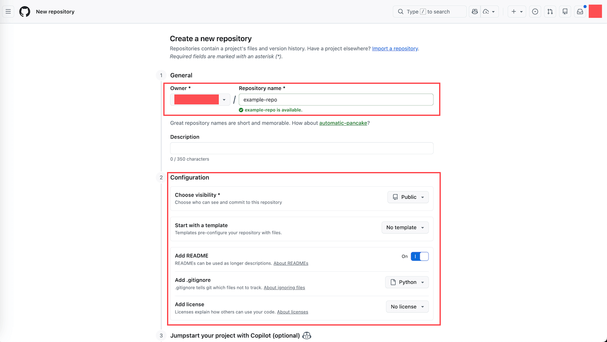

# Create Your First GitHub Repository: The Starting Point of a Digital Project

> Create a GitHub Repository of your very own from scratch, and understand why it is the foundation of how modern teams work together.

## 1. Overview

This is the first lesson in the "Learn GitHub Basics" series. In this lesson, you will create the very first GitHub Repository (Repo for short) of your life, and figure out exactly what each creation option really does.

The interesting part is this: a Repo looks like nothing more than a folder on a web page, but it is actually the doorway to an entire way of working. Once you understand it, the way you look at "a project" will change. The four lessons that follow in this series (editing files, using a Git branch, merging a branch, and putting everything up on GitHub) all continue to work on the Repo you create in this lesson, so this step is the foundation of the whole learning path.

---

## 2. Learning Objectives

Picture a very common scenario. You and a few coworkers are writing a report together. You finish the first draft and send it to coworker A, who edits it and sends it to B, who sends it back to you, so you make another revision, only to find out coworker C also made their own edits on their side yesterday. Now there are five files sitting on your desktop, all named things like report-final, report-final-v2, and report-final-real, and nobody can say for sure which one is actually the latest version. Almost every team has been through this kind of mess.

A Repo exists precisely to solve this problem. It is a shared project space where everyone works in the same place and every change is recorded. When you learn to use a Repo, you are not just picking up a tool, you are picking up a core skill of modern team collaboration. Whether you write code, write documents, or manage any kind of digital asset, this way of thinking applies. That is exactly why we put it in the first lesson.

After finishing this Task, you will be able to:

1. Explain in your own words what a Repository is, and how it differs from an ordinary folder.
2. Independently create a correctly configured GitHub Repository.
3. Understand what each creation setting does (visibility, README, .gitignore, license, and so on), and make sensible choices for your own projects.

---

## 3. Prerequisites

- A GitHub account that you can log in to normally.
- A modern browser (this entire series is done in the browser, with no software to install).
- The ability to open a web page and click buttons; no programming experience required.

---

## 4. What You Will Build or Learn

After finishing this lesson, you will have a real Public Repository that is truly your own. It will contain at least one automatically generated README.md file, and you can open its home page at any time to see the repository name and the contents of the README. This Repo will become your "workbench" for the next several lessons, and every exercise that follows is done on top of it.

---

## 5. What Is a Repository

You can think of a Repository as a folder on your computer, but it is far more powerful. Rather than calling it a folder, it is better described as a "smart project folder." Let's use a comparison to see where its strength lies.

- An ordinary folder can only store files, while a Repo stores files and also records the history of every change.
- An ordinary folder is usually used by one person, while a Repo is built for multiple people to collaborate.
- An ordinary folder is hard to recover once you make a mistake, while a Repo can travel back in time to any earlier version whenever you want.
- An ordinary folder has no idea who changed what, while a Repo keeps a clear record of every single change.

Once you understand this comparison, you have grasped the three core values of a Repo.

First, it is a container for a project. All the code of a website, the documents and assets of a product, or the scripts and reports of a data analysis project can all be held completely inside a single Repo.

Second, it is the unit of team collaboration. You can invite coworkers to join, and GitHub records who changed what; when someone's change conflicts with another person's, it warns you; and it also lets you review other people's changes.

Third, it is the smallest unit of permission management. You can control precisely who can view (Read), who can change (Write), and who can manage (Admin). For example, an intern can only view but not change, and an outside partner can only access a specific project.

---

## 6. Getting to the Creation Page

Before you actually fill out the form, you first need to find the entry point for creating a Repo. GitHub offers two ways, and either one works.

Option one: look at the top right of the page. Next to your avatar there is a "+" icon; click it to open the dropdown menu and choose "New repository."

Option two: go to your personal home page, where there is a "Repositories" tab at the top; click into it, and on the right there is a green "New" button.

No matter which path you take, you will arrive at the same page, titled "Create a new repository." Next, we will fill out the fields one by one.

---

## 7. Filling In the Basic Information

This screen asks you to fill in three things.

Owner. This dropdown shows who the Repo belongs to. If you are using a personal account, this will be your username. If you belong to an Organization, you can also choose to create it under the organization name.

Repository name. This is where it pays most to build good habits. We recommend lowercase letters, with words separated by hyphens -, no spaces or underscores, and a name that is short but descriptive. Because this is your first practice repository for learning GitHub, a good name is to combine your own name with the course topic, for example john-doe-learn-github-basic. That way, when you look back later, you can tell at a glance what it is for. As you type, GitHub automatically checks whether the name is available, and if it is, a green check mark and "is available" appear next to it.

Description. This field is optional, a single sentence explaining what the project is about. Although you can leave it blank, we still recommend filling it in, so that when you or someone else sees it in a list later, it is clear at a glance.

---

## 8. Configuration Options

Further down is the Configuration section, which is also the part that most deserves your understanding. The image below shows this configuration area.

Let's go through it item by item.

Choose visibility. There are two options. Public means anyone can see it, which suits open source projects and learning exercises. Private means only you and the people you invite can see it, and many projects in real work choose this. For this lesson, please choose Public. The reason is simple: we are only using this Repo to practice the basic operations of creating, editing files, and committing, so choosing Public saves you all the hassle of permissions and invitations and lets you focus on the operations themselves. Later, when you want to put something truly private in a Repo, you can switch to Private at any time.

Start with a template. As a beginner, just keep the default of No template.

Add a README. The README is a special file used to introduce the project. When someone (or the future you) opens this Repo, it is the first thing they see. We strongly recommend turning this on (On); GitHub will automatically create a README.md for you, already containing content with the project name as its heading, which you can edit however you like afterward.

Add .gitignore. This file tells Git which files do not need to be tracked, such as temporary files, logs, or config that contains passwords. The dropdown has common options like Python, Node, and Java. If you are not sure, you can pick the one closest to your project type, or choose None for now.

Add license. A license decides how others may use your code. If it is just a private project or a learning project, you usually do not need one, and we recommend choosing No license.

---

## 9. Finishing the Creation

Once the three pieces of information are filled in and the configuration is set, click the green "Create repository" button at the bottom of the page.

The page will jump to the home page of your new Repo. You will see the repository name appear in the top left, and the contents of README.md displayed in the center of the page. If you just chose a .gitignore, you will also see that .gitignore file in the file list. At this point, your first Repo is officially born.

---

## 10. Exercises

### Exercise 1: Create Your Own First Public Repository

**Goal:** Walk through the entire creation flow on your own and end up with a correctly configured Public Repository.

**What to do:**

1. Use either of the methods in Section 6 to get to the "Create a new repository" page.
2. Enter a name in Repository name; we recommend combining your name with the course topic, for example john-doe-learn-github-basic.
3. Set Visibility to Public.
4. Check Add a README.
5. Click the green "Create repository" button at the bottom.

**What you will observe:**

The page jumps to the home page of the new Repo, with the repository name you just entered in the top left (with a Public label next to it), the contents of README.md displayed in the center, and the README.md file visible in the file list.

> **Key insight:** Creating a Repo takes less than 5 minutes, but these few short steps turn a project from "scattered files" into "a bounded, historied, collaborative space."

### Exercise 2: Use an Incognito Window to Verify It Really Is Public

**Goal:** See with your own eyes that "Public" means anyone in the world can view your Repo, even if they are not logged in to GitHub at all.

**What to do:**

1. Go back to the home page of the Repo you just created and copy the URL from the address bar, in the form https://github.com/USERNAME/REPO_NAME (replace USERNAME and REPO_NAME with your own).
2. Open your browser's incognito window (Chrome and Edge call it Incognito or InPrivate, Safari calls it Private Browsing). An incognito window carries none of your login state, which is like a stranger who has never logged in to GitHub, and you use it to simulate "the whole world."
3. Paste the URL you just copied into the incognito window and press Enter.

**What you will observe:**

Even though this window is not logged in at all, you can still see the full contents of this Repo: the files, the README, and the commit history are all there. At the same time, notice the small Public label next to the repository name at the top of the page, clearly telling you that this project is visible to everyone.

> **Key insight:** Public is not an abstract setting but a very concrete "anyone on earth can access this." This is both the power of open source collaboration and a security boundary you will need to take seriously later. In lesson 06 we will create a Private Repo and look at it through the same incognito window, and the result will be exactly the opposite.

---

## 11. Recap: What We Learned

- A Repository is a smart project folder: it stores files, records history, supports collaboration, and controls permissions.
- One Repo corresponds to one project, which is the most natural and clearest way to organize things.
- The practice Repo in this lesson is Public for the sake of convenience; when you want to put private content in real work, use Private, and you can switch between the two at any time.
- Always check Add a README, since it is the face of the project.
- Choose .gitignore based on the project type, and if you are not sure, start with None.
- Naming habits matter: lowercase letters with hyphens, short but descriptive.

---

## 12. A Word from Your Mentor

**Why this exercise matters:**

The moment you click "Create repository," you are not just creating a folder, you are establishing a new way of thinking about work. I call it the shift from "file thinking" to "project thinking." File thinking is a pile of files scattered across your computer, edited and passed back and forth, where nobody knows which is the latest version and nobody knows who changed what, and once the project ends the files scatter and can never be gathered again. Project thinking is like this: every project has a home, namely its Repository, everyone comes here to work, every change is traceable and reversible, and the entire lifecycle is crystal clear.

**Key insights:**

- A Repository has never been just a tool for programmers. Product managers use it to manage product documents, requirements, and meeting notes; data analysts use it to manage scripts, reports, and data dictionaries; content creators use it to manage drafts, assets, and publishing records; project managers use it to manage plans, progress, and risk lists. The point is not what kind of work you do, but whether you need collaboration and version management.
- It is worth building the habit of "create the Repo first." Every time you start a new project, the first thing you do is create a Repo, no matter how small the project is. The benefit is that you have clear boundaries from day one, all files have version records from the very beginning, you can invite others to join at any time, and when the project ends you are left with a complete historical archive.

**Next step:**

Bring this habit into your real work. Next time you have any new idea or new task, do not rush to create a folder on your desktop; create a Repo first. The second lesson of this series will guide you through editing files on this Repo, and our journey has only just begun.

---

## 13. Quick Reference

**Creation entry point:** The "+" icon next to your avatar in the top right, choose New repository; or the green New button in the Repositories tab on your personal home page.

**Recommended configuration:** For this lesson's exercise, set Visibility to Public, check Add a README, choose .gitignore by project type or start with None, and choose No license.

**Naming rules:** Lowercase letters, hyphens between words, no spaces or underscores, short and descriptive. For the practice repository, we recommend combining your name with the course topic, like john-doe-learn-github-basic.

**Key files:**

- `README.md`: The face of the project, the first thing others see when they open the Repo.
- `.gitignore`: Tells Git which files not to track (optional).
