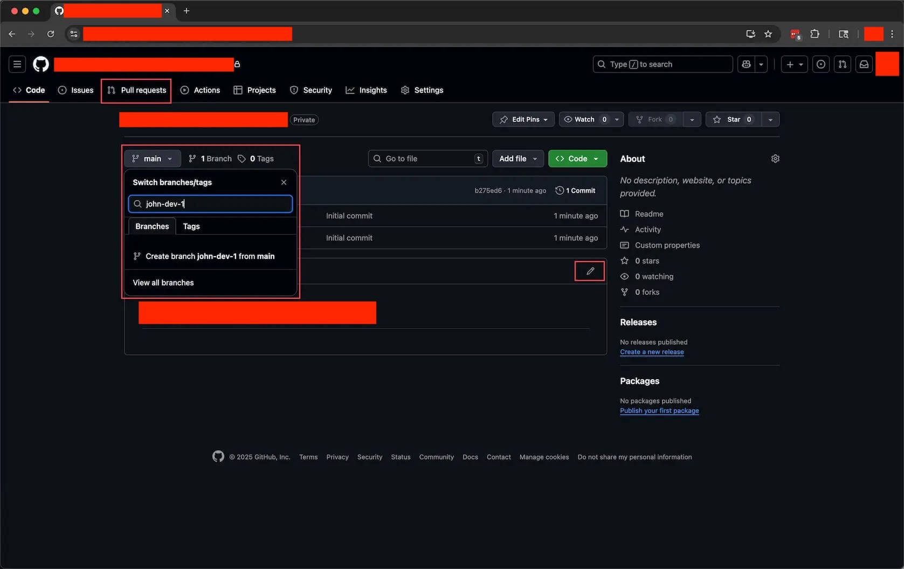
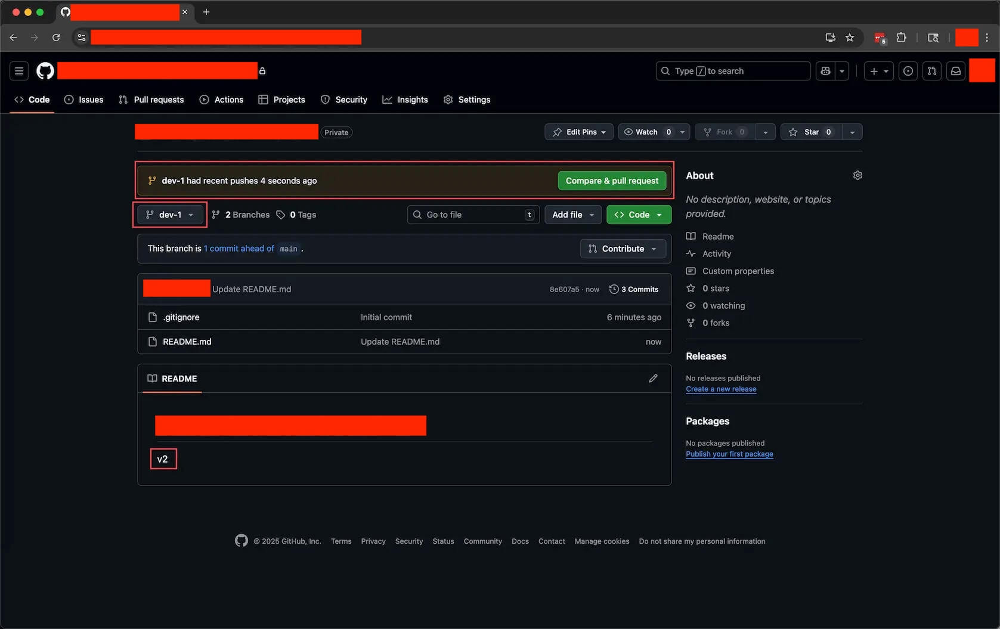

# Git Branch: 用分支管理你的平行宇宙

> 本节教你理解 Branch 是什么, 何时用, 并在你自己的 repo 上创建分支, 切换分支, 见证不同分支上的文件互不影响.

## 1. 概览

这是 "Learn GitHub Basics" 系列的第三节. 在 01 你创建了自己的 repo, 在 02 你学会了在网页端编辑 README. 本节我们进入一个真正改变你工作方式的概念: Branch (分支).

如果说 Commit 是时间轴上的存档点, 那么 Branch 就是创造平行宇宙的能力. 你可以在一条新的时间线上随便尝试, 修改, 实验, 而完全不影响原来那条. 整节课你都会在自己那个 repo 上操作, 全程网页端, 不需要装任何工具.

---

## 2. 学习目标

你在做项目时一定遇到过这种纠结: 做到一半突然有个新想法想试试, 又担心万一不 work 会把已经做好的部分弄乱. 或者你和同事要同时开发两个不同的功能, 怎么才能互不干扰. Branch 就是专门解决这类问题的. 学会它, 你面对不确定性时就多了一份底气: 主线永远安全, 你尽管大胆去试.

学完这个 Task, 你将能够:

1. 用自己的话解释 Branch 是什么, 以及它和 Commit 的关系.
2. 在 GitHub 网页上从 main 创建一个新的 Branch.
3. 在不同 Branch 之间自由切换, 并在独立 Branch 上修改文件而不影响 main.
4. 养成随时确认自己在哪个 Branch 的意识, 知道怎么从分支切换器看出当前分支和已有分支.

---

## 3. 前置知识

- 已完成 01 Create Repo 和 02 Edit Files, 你有一个属于自己的 repo.
- 这个 repo 里有一个可以编辑的 README.md 文件.
- 会用 GitHub 网页端的铅笔图标进入编辑模式并提交 Commit.

---

## 4. 你将构建或学到什么

你会在自己的 repo 里得到两条时间线: main 分支上的 README 显示 v1, 新建的 dev-1 分支上的 README 显示 v2. 当你在两个分支间来回切换时, 会亲眼看到同一个文件的内容随分支而变. 这个 "亲眼所见" 的瞬间, 就是本节最重要的收获.

---

## 5. 什么是 Branch: 平行宇宙的工作方式

Branch 像是从当前时刻分叉出去的一条独立时间线.

举个例子. 你在写一篇博客文章, 已经写好了三段. 现在你有两个想法: 方案 A 是保持现在的风格继续往下写, 方案 B 是换一种完全不同的风格重写. 传统做法是把文件复制一份, 叫 "博客_ 新风格.docx". 但如果你还想同时试方案 C, 方案 D, 文件就会越来越多, 越来越乱.

用 Branch 就干净多了. 你从 main (主时间线, 上面已经有 "写了前三段" 这个 Commit) 分出两条分支:

- try-new-style 分支: 在里面用全新的风格重写.
- add-examples 分支: 在每一段后面加上实例, 补充图表.

这两条分支各自独立, 谁也不影响谁. 三个关键点:

- 每个 Branch 都是从某一个 Commit 分叉出去的.
- 一个 Branch 上的修改, 完全不影响其他 Branch.
- 你可以随时在不同 Branch 之间切换, 就像在平行宇宙之间穿梭.

---

## 6. 什么时候会用到 Branch

Branch 的用武之地主要有两类.

场景一, 你一个人开发, 想同时尝试多个方向. main 保持当前的稳定版, feature-A 试方案 A, feature-B 试方案 B, experiment 放你最大胆的实验. 在 feature-A 上做累了, 切到 experiment 换换脑子, 两边互不干扰, 一点都不会乱.

场景二, 团队协作, 多人同时开发. main 是主版本, 每个人开一个自己的分支: alice-login 做登录, bob-payment 做支付, carol-ui 做界面. 大家各写各的, 谁也不踩谁, 各自完成后再合并回 main.

Branch 给你的, 其实是四种自由:

- 敢于尝试: 独立分支上怎么折腾都不会影响主版本.
- 并行工作: 同时推进多个想法.
- 灵活切换: 随时在不同任务间切换, 不丢进度.
- 安全实验: 再极端的实验也放心做, 大不了把那个 Branch 删掉.

---

## 7. 一个必须养成的习惯: 时刻知道自己在哪个 branch

有了多个 branch 之后, 一个新问题马上冒出来: 你现在到底站在哪一条时间线上? 这是初学者最容易忽略, 也最容易栽跟头的地方, 所以我们专门拿一节来讲清楚.

每次打开 GitHub 网页, 第一件事就是瞟一眼左上方的分支切换器. 它会明确告诉你两件事: 你当前在哪个 branch (按钮上显示的就是当前分支名, 比如 main 或 dev-1), 以及这个 repo 一共有几个 branch (紧挨着的 "X Branches"). 点开这个按钮, 还能看到全部分支的列表. 后面练习里的那张分支切换器截图, 你可以对照着看.

为什么这件事这么关键? 因为不同 branch 上的文件可以完全不一样. 同一个文件, 在一个分支上是 v2, 在另一个分支上还是 v1; 更极端的情况是, 某个文件在这个分支上存在, 在那个分支上压根还没创建. 很多人都遇到过这种困惑: "我明明改过 (或者加过) 这个文件, 怎么现在找不到了?" 十有八九不是文件丢了, 而是你当前正站在另一条时间线上.

所以请把这句话刻进肌肉记忆: 动手改任何东西之前, 先确认 "我现在在哪个 branch". 提交的时候也一样, Commit 对话框里那句 "Commit directly to the <branch> branch", 就是在最后关头再提醒你一次, 这次改动到底要落到哪条时间线上. 养成这个意识, 你就绕开了用 branch 时最常见的那一类错误.

---

## 8. 练习

下面三个练习在你自己的 repo 上连续完成. 做完你就完整走过了 "创建分支, 分支上修改, 切换见证" 的全流程.

### 练习 1: 在 main 分支做第一次修改作为基准

**目标:** 在 main 分支上给 README 加一行 v1 并提交, 作为后面对比的基准.

**怎么做:**

1. 在 repo 里点开 README.md 进入文件查看页, 再点右上角的铅笔图标进入编辑模式. 左上角出现 Edit 和 Preview 两个标签, 说明你已经在编辑了.
2. 在文件里加一行文字 v1.
3. 点右上角绿色的 "Commit changes..." 按钮, 弹出对话框. Commit message 默认是 "Update README.md", 不用改; Extended description 留空; 提交选项确认选中的是 "Commit directly to the main branch".
4. 点绿色的 "Commit changes" 完成提交.

**你会观察到:**

你完成了 main 分支上的第一个 Commit, README 里现在有了 v1 这一行.

> **关键洞见:** 这一步是给平行宇宙定下一个共同的起点. 后面新分支就是从这个 Commit 分叉出去的.

### 练习 2: 创建新分支并做不同的修改

**目标:** 新建一个 dev-1 分支, 在上面把 v1 改成 v2 并提交.

**怎么做:**

1. 回到仓库主页, 看左上方的分支切换器. 这个下拉按钮会显示当前分支名 main, 旁边显示 X Branches 和 0 Tags.
2. 点开显示 main 的下拉菜单, 在搜索框里输入新分支名 dev-1. GitHub 会显示一条提示 "Create branch dev-1 from main", 点这条提示.
3. 创建成功后, 分支切换器显示 dev-1, 页面上会写着 "This branch is even with main".
4. 点开 README.md 进入查看页, 点铅笔进入编辑, 把 v1 改成 v2.
5. 点 "Commit changes...", 这次确认选中的是 "Commit directly to the dev-1 branch", 再点 Commit changes.

**你会观察到:**

提交后回到主页, 分支切换器显示 dev-1, README 显示 v2. 页面顶部还会出现一条黄色提示条 "dev-1 had recent pushes X seconds ago", 旁边有一个绿色的 "Compare & pull request" 按钮 (这个按钮我们下一节再用, 本节先不管它).

> **关键洞见:** 你刚刚在 dev-1 这条新时间线上做了修改, 而 main 那条时间线原封不动.

### 练习 3: 见证 Branch 的魔力

**目标:** 在 dev-1 和 main 之间切换, 亲眼看到 README 的内容随分支变化.

**怎么做:**

1. 确认你现在在 dev-1 分支, README 显示 v2.
2. 点开分支切换器, 选择 main, 等页面刷新.
3. 看 README 的内容.
4. 再切回 dev-1, 再看一次.

**你会观察到:**

切到 main 时 README 又变回 v1 了! 切回 dev-1 时又是 v2. dev-1 上是 v2, main 上是 v1, 两个分支各自独立, 互不影响. 你可以来回切换, 每次文件内容都变成对应分支的版本, 就像在两个平行宇宙之间穿梭.

> **关键洞见:** 这就是 Branch 的魔力. 你没有复制文件, 也没有丢掉任何东西, 同一个 README 在不同分支上就是不同的内容.

---

## 9. 回顾: 我们学到了什么

- Branch 是平行宇宙: 一条独立的时间线, 上面的修改不影响其他分支.
- main 是主分支, 存放正式的版本.
- 创建分支: 在分支切换器的搜索框里输入名字, 点 "Create branch ... from main".
- 切换分支: 点分支切换器, 选目标分支.
- 操作前先看分支切换器, 时刻清楚自己在哪个 branch; 找不到某个文件, 先怀疑是不是站错了分支.
- 典型用途: 试新想法, 多人协作, 安全实验.
- 核心价值: 让你敢尝试, 能并行.

---

## 10. 导师寄语

**为什么这个练习重要:**

你在这节学到的不只是几个网页操作技巧, 而是一种思维方式的转变: 从 "线性思维" 到 "并行思维". 线性思维是做完 A 才能做 B, 一旦 A 错了, B 和 C 都得跟着改. 并行思维是 A, B, C 同时进行互不干扰, 哪个走通了就合并回来, 走不通就直接废弃, 毫无损失.

**关键洞见:**

- 面对不确定性, 你会更愿意同时探索多个方向.
- 面对风险, 你会更敢大胆尝试, 因为主线始终安全.
- 面对复杂任务, 你会更善于把它分解成可以并行的部分.
- Branch 是 "免费" 的: 创建几乎不占资源, 删除也毫无成本. 与其在一个分支上小心翼翼, 不如多开几个大胆探索.

**下一步:**

养成一个习惯: 每当你冒出一个 "试试看" 的念头, 就顺手创建一个新分支. 到了下一节 04 Merge Branch, 你会学到怎么把某条走通的时间线合并回 main.

---

## 11. 速查

**创建分支:** 分支切换器搜索框输入名字, 点 "Create branch <name> from main".

**切换分支:** 点分支切换器, 选目标分支.

**认准当前分支:** 左上方分支切换器按钮上显示的就是你当前所在的 branch, 旁边的 "X Branches" 是分支总数.

**在指定分支提交:** 编辑后在 Commit 对话框确认选中 "Commit directly to the <branch> branch".

**关键文件:**

- `README.md`: 本节练习中反复编辑的文件, 在 main 上是 v1, 在 dev-1 上是 v2.

---

## 12. 参考实现

本节没有需要运行的代码. 参考成果就是你自己 repo 里的状态: main 分支的 README 显示 v1, dev-1 分支的 README 显示 v2, 两者切换互不影响.
