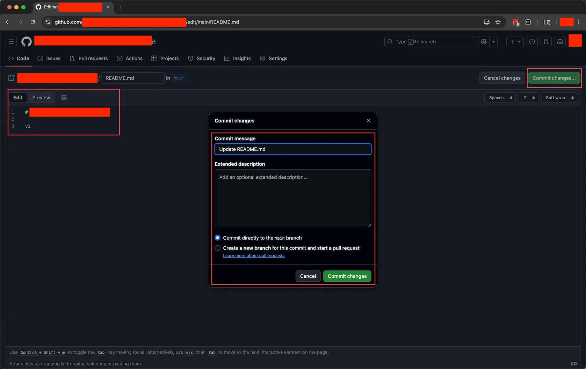

# Git Branch: Managing Your Parallel Universes

> This section teaches you what a Branch is and when to use one. You will create a branch on your own repo, switch between branches, and watch the files on different branches stay completely independent of each other.

## 1. Overview

This is the third section of the "Learn GitHub Basics" series. In 01 you created your own repo, and in 02 you learned to edit the README from the web UI. In this section we get into a concept that genuinely changes the way you work: the Branch.

If a Commit is a save point on a timeline, then a Branch is the power to create parallel universes. You can try things, make changes, and run experiments on a brand new timeline without affecting the original one at all. You will do everything in this section on your own repo, entirely in the web UI, with no tools to install.

---

## 2. Learning Objectives

You have almost certainly hit this dilemma while working on a project: you are halfway through when a new idea strikes and you want to try it, but you worry that if it does not work out you will mess up the part you already finished. Or maybe you and a coworker need to build two different features at the same time, and you want a way to stay out of each other's way. Branches exist to solve exactly this kind of problem. Once you know how to use them, you can face uncertainty with more confidence: the main line stays safe no matter what, so go ahead and experiment boldly.

After finishing this Task, you will be able to:

1. Explain in your own words what a Branch is and how it relates to a Commit.
2. Create a new Branch from main in the GitHub web UI.
3. Switch freely between different Branches, and change files on an isolated Branch without affecting main.
4. Build the habit of always confirming which Branch you are on, and know how to read the current branch and existing branches from the branch switcher.

---

## 3. Prerequisites

- You have finished 01 Create Repo and 02 Edit Files, so you have a repo of your own.
- That repo contains a README.md file you can edit.
- You know how to use the pencil icon in the GitHub web UI to enter edit mode and make a Commit.

---

## 4. What You Will Build or Learn

You will end up with two timelines in your own repo: the README on the main branch shows v1, and the README on a new dev-1 branch shows v2. As you switch back and forth between the two branches, you will watch the contents of the same file change with the branch. That "seeing it with your own eyes" moment is the most important takeaway of this section.

---

## 5. What Is a Branch: Working the Parallel-Universe Way

A Branch is like an independent timeline that forks off from the current moment.

Here is an example. You are writing a blog post and have three paragraphs done. Now you have two ideas: option A is to keep the current style and keep writing, and option B is to rewrite it in a completely different style. The traditional approach is to copy the file and call it "blog_new-style.docx". But if you also want to try option C and option D at the same time, the files pile up and get messier and messier.

A Branch is much cleaner. From main (the main timeline, which already has the "wrote the first three paragraphs" Commit on it) you fork two branches:

- try-new-style branch: rewrite everything in a brand new style here.
- add-examples branch: add a concrete example after each paragraph and throw in some diagrams.

These two branches are independent, and neither affects the other. Three key points:

- Every Branch forks off from some particular Commit.
- Changes on one Branch do not affect any other Branch at all.
- You can switch between Branches whenever you like, like traveling between parallel universes.

---

## 6. When You Would Use a Branch

Branches shine mainly in two kinds of situations.

Scenario one: you are working solo and want to try several directions at once. main holds the current stable version, feature-A tries option A, feature-B tries option B, and experiment holds your boldest experiment. When you get tired of working on feature-A, switch over to experiment for a change of pace. The two never interfere, and nothing gets tangled up.

Scenario two: team collaboration, with several people building at the same time. main is the main version, and everyone opens a branch of their own: alice-login handles login, bob-payment handles payments, and carol-ui handles the interface. Everyone works on their own without stepping on anyone else, and once each person is done they merge back into main.

What a Branch really gives you is four kinds of freedom:

- Freedom to try: no matter how much you mess around on an isolated branch, the main version is untouched.
- Freedom to work in parallel: push several ideas forward at the same time.
- Freedom to switch: move between tasks whenever you want without losing progress.
- Freedom to experiment safely: run even the most extreme experiment with peace of mind, since the worst case is just deleting that Branch.

---

## 7. A Habit You Must Build: Always Know Which branch You Are On

Once you have several branches, a new question pops up right away: which timeline are you actually standing on right now? This is the spot beginners most often overlook and most often trip over, so we are dedicating a whole section to nailing it down.

Every time you open the GitHub web UI, the first thing to do is glance at the branch switcher in the top left. It tells you two things clearly: which branch you are currently on (the button shows the current branch name, such as main or dev-1), and how many branches this repo has in total (the "X Branches" right next to it). Click the button open and you can also see the full list of branches. You can follow along with the branch switcher screenshot in the exercises below.

Why does this matter so much? Because the files on different branches can be completely different. The same file can be v2 on one branch and still v1 on another; in an even more extreme case, a file might exist on one branch and not have been created at all on another. Plenty of people have run into this confusion: "I clearly changed (or added) this file, so why can't I find it now?" Nine times out of ten the file is not lost, you are just standing on a different timeline.

So burn this into your muscle memory: before you change anything, confirm "which branch am I on right now". The same goes for committing. That line in the Commit dialog, "Commit directly to the <branch> branch", is one last reminder at the final moment about which timeline this change is going to land on. Build this awareness and you will sidestep the single most common category of mistakes people make with branches.

---

## 8. Exercises

Do the following three exercises back to back on your own repo. When you are done you will have walked through the full flow of "create a branch, change something on the branch, switch and witness the result".

### Exercise 1: Make a First Change on main as a Baseline

**Goal:** Add a v1 line to the README on the main branch and commit it, as a baseline for the comparison later.

**How to do it:**

1. Open README.md in the repo to reach the file view page, then click the pencil icon in the top right to enter edit mode. When the Edit and Preview tabs appear in the top left, you know you are editing.
2. Add a line of text, v1, to the file.
3. Click the green "Commit changes..." button in the top right to bring up the dialog. The Commit message defaults to "Update README.md", which you can leave as is; leave Extended description empty; and confirm the commit option selected is "Commit directly to the main branch".
4. Click the green "Commit changes" to finish the commit.

**What you will observe:**

You have made the first Commit on the main branch, and the README now has a v1 line in it.

> **Key insight:** This step sets a shared starting point for the parallel universes. The new branch later forks off from exactly this Commit.

### Exercise 2: Create a New Branch and Make a Different Change

**Goal:** Create a new dev-1 branch and, on it, change v1 to v2 and commit.

**How to do it:**

1. Go back to the repo home page and look at the branch switcher in the top left. This dropdown button shows the current branch name, main, with X Branches and 0 Tags next to it.
2. Click open the dropdown showing main and type the new branch name, dev-1, into the search box. GitHub shows a prompt, "Create branch dev-1 from main"; click that prompt.
3. Once it is created, the branch switcher shows dev-1, and the page reads "This branch is even with main".
4. Open README.md to reach the view page, click the pencil to enter edit mode, and change v1 to v2.
5. Click "Commit changes...", this time confirm the option selected is "Commit directly to the dev-1 branch", then click Commit changes.

**What you will observe:**

After committing, go back to the home page: the branch switcher shows dev-1 and the README shows v2. A yellow banner also appears at the top of the page, "dev-1 had recent pushes X seconds ago", with a green "Compare & pull request" button next to it (we will use that button in the next section, so ignore it for now).

> **Key insight:** You just made a change on the dev-1 timeline, while the main timeline stayed exactly as it was.

### Exercise 3: Witness the Magic of Branches

**Goal:** Switch between dev-1 and main, and watch the README contents change with the branch right before your eyes.

**How to do it:**

1. Confirm you are on the dev-1 branch and the README shows v2.
2. Click open the branch switcher, choose main, and wait for the page to refresh.
3. Look at the README contents.
4. Switch back to dev-1 and look again.

**What you will observe:**

When you switch to main, the README turns back into v1! Switch back to dev-1 and it is v2 again. dev-1 has v2 and main has v1; the two branches are independent and do not affect each other. You can switch back and forth, and each time the file contents become the version for that branch, like traveling between two parallel universes.

> **Key insight:** This is the magic of a Branch. You did not copy the file and you did not lose anything, yet the same README simply has different contents on different branches.

---

## 9. Recap: What We Learned

- A Branch is a parallel universe: an independent timeline whose changes do not affect other branches.
- main is the main branch, where the official version lives.
- Create a branch: type a name into the branch switcher's search box and click "Create branch ... from main".
- Switch branches: click the branch switcher and choose the target branch.
- Look at the branch switcher before you act, and always know which branch you are on; if you cannot find a file, first suspect that you are on the wrong branch.
- Typical uses: trying a new idea, collaborating with several people, running safe experiments.
- Core value: it lets you dare to try and work in parallel.

---

## 10. A Note from Your Mentor

**Why this exercise matters:**

What you learned in this section is not just a few web UI tricks, but a shift in mindset: from "linear thinking" to "parallel thinking". Linear thinking means you can only start B after finishing A, and the moment A turns out wrong, B and C have to change along with it. Parallel thinking means A, B, and C run at the same time without interfering; whichever one pans out gets merged back, and whichever one does not gets discarded at no cost.

**Key insights:**

- Facing uncertainty, you will be more willing to explore several directions at once.
- Facing risk, you will dare to experiment more boldly, because the main line always stays safe.
- Facing a complex task, you will get better at breaking it into parts that can run in parallel.
- Branches are "free": creating one costs almost no resources, and deleting one costs nothing either. Rather than tiptoe around on a single branch, open a few more and explore boldly.

**Next step:**

Build a habit: whenever a "let me try this" idea strikes, create a new branch on the spot. In the next section, 04 Merge Branch, you will learn how to merge a timeline that panned out back into main.

---

## 11. Quick Reference

**Create a branch:** type a name into the branch switcher's search box and click "Create branch <name> from main".

**Switch branches:** click the branch switcher and choose the target branch.

**Identify the current branch:** the branch switcher button in the top left shows the branch you are currently on, and the "X Branches" next to it is the total number of branches.

**Commit on a specific branch:** after editing, confirm "Commit directly to the <branch> branch" is selected in the Commit dialog.

**Key files:**

- `README.md`: the file you edit over and over in this section's exercises; it is v1 on main and v2 on dev-1.

---

## 12. Reference Implementation

There is no code to run in this section. The reference result is the state of your own repo: the README on the main branch shows v1, the README on the dev-1 branch shows v2, and switching between the two does not affect either one.
