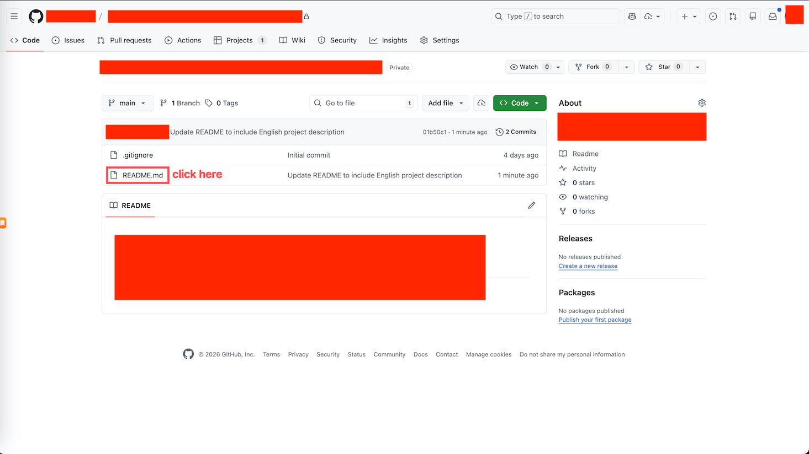
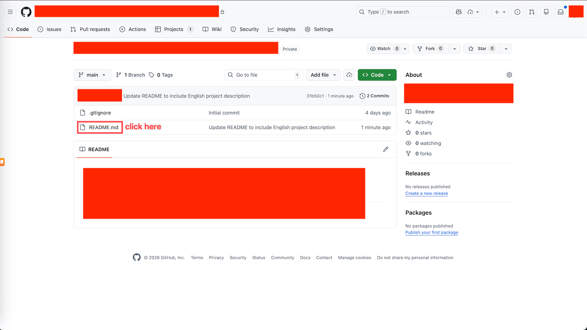
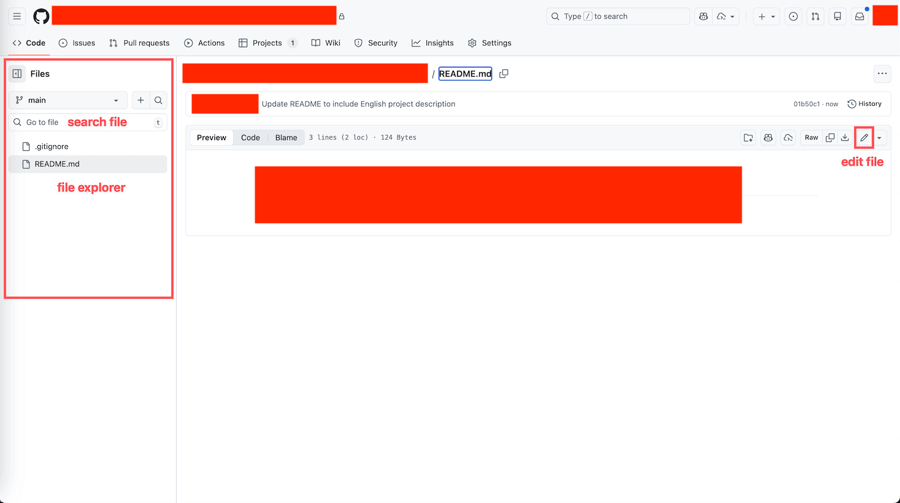
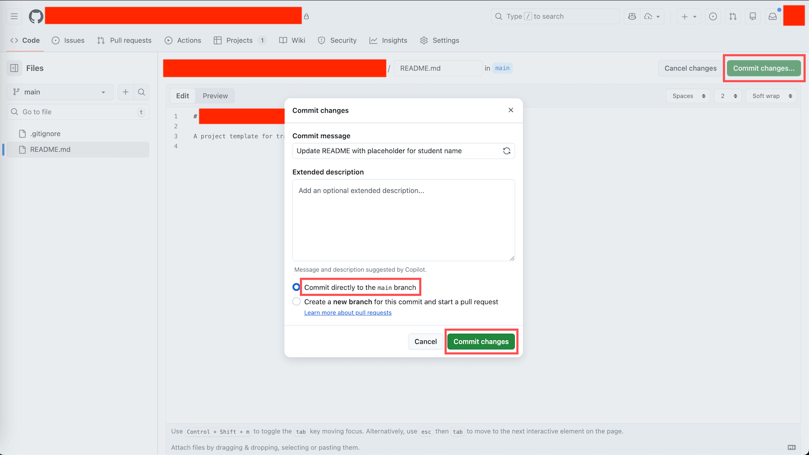

# Editing Files on the GitHub Web Interface: Your Cloud Document Editor

> This lesson teaches you to browse and edit files directly in your own repo using GitHub's web interface, with no software to install.

## 1. Overview

In the previous lesson (03 Create Repo), you created your own repo with a README.md inside it. This lesson picks up right there and uses that same repo for practice. You will discover that GitHub's web interface is itself a fully capable text editor. Open a browser, click around a bit, and you can change files and save those changes permanently, all without ever touching the command line or installing a single tool.

---

## 2. Learning Objectives

Keeping an important document only on your local computer is risky. If the computer breaks, the document is gone. Switch to a different computer and you can no longer edit it. Putting important documents on GitHub solves all of these headaches at once: access them anytime, anywhere (any device with a browser can view and edit them), keep an automatic version history (every change is recorded, so mistakes are recoverable), and make it easy for others to view them directly. Even better, you do not need to install anything to get this. GitHub's web interface is all you need.

By the end of this Task, you will be able to:

1. Read the layout of a Repository page and recognize the file list and the content preview area.
2. Open a file two different ways (click the file name directly, or use the File Explorer).
3. Enter edit mode to change a file's content, and use Commit Changes to save the edit to the main branch.

---

## 3. Prerequisites

- You have completed 03 Create Repo and own your own repo with a README.md inside it.
- You know how to sign in to your GitHub account in a browser.

---

## 4. What You Will Build or Learn

You will add a line with your name to the README.md in your own repo and save it successfully. Once saved, this change appears in the file's edit history, tagged with the Commit Message you wrote and a timestamp. This is the first official edit you leave behind on GitHub.

---

## 5. Getting to Know the Repository Page

Open your repo and you will see a page that looks like a folder. It is mainly split into two parts.

**The file list area**: The middle of the page shows the file list. You may see `.gitignore` (a system file you can ignore for now) and `README.md` (the project's documentation, usually the first file people look at after opening a repo). Each file name is followed by its most recent change description (Commit Message) and the time it was changed.

**The file content preview area**: Below the file list, GitHub automatically displays the README's content. GitHub is considerate here: it automatically renders `README.md` into a nicely formatted layout instead of showing you the raw text.

---

## 6. How to Open a File

There are two ways to open a file, and either one works.

**Option 1, click the file name directly**: In the file list, click a file name (such as `README.md`) and the page jumps to that file's detail view.

**Option 2, use the File Explorer**: After you open any file, a panel appears on the left side of the page. This is the File Explorer. It contains three things: a branch selector (showing `main`, which is the branch you are currently on), a search box (labeled "Go to file", where typing a file name quickly locates it), and the full file directory tree. When a repo has many files, the search box makes finding things very convenient.

---

## 7. How to Edit a File

Editing a file takes three steps.

**Step 1, enter edit mode**: When you open a file, you see Preview mode (the nicely rendered layout). In the top-right corner of the page, find the pencil icon (the Edit file button, on the same row as Raw, Blame, and similar buttons) and click it to switch to edit mode.

**Step 2, change the content**: Edit mode has two tabs. The Edit tab shows the raw Markdown text with line numbers, and this is where you change the content just like using a notepad. The Preview tab lets you preview how your changes will look. Just type away in the Edit tab.

**Step 3, save your changes (Commit Changes)**: When you are done, click the green "Commit changes..." button in the top-right corner and a dialog pops up. A few things in the dialog are worth noting:

- Commit message: a short one-line description of what you changed this time, such as "Update README with my name".
- Extended description: an optional detailed description, and leaving it blank is fine.
- Two radio options: "Commit directly to the main branch" (choose this one to save straight to the main branch) and "Create a new branch..." (ignore this for now in this lesson).

Confirm that "Commit directly to the main branch" is selected, then click the green "Commit changes" button, and the save is done.

---

## 8. About Branches: Nothing to Worry About in This Lesson

The branch you see in the save dialog is an advanced Git feature. It lets many people change different versions at the same time without interfering with one another. But you do not need to understand it at all in this lesson. As long as you always stay on the `main` branch and choose "Commit directly to the main branch" when saving, you are good. A later lesson (05 Working with Git Branch) will explain exactly how branches work.

---

## 9. Exercises

### Exercise 1: Add Your Name to README.md

**Goal:** Add a line with your name to the README.md in your own repo, and save the change to the main branch.

**How to do it:**

1. Open the repo you created in the previous lesson.
2. Find and click `README.md` in the file list.
3. Click the pencil icon in the top-right corner to enter edit mode.
4. Add a line with your name to the file, such as "Maintained by John Smith".
5. Click the "Commit changes..." button.
6. Enter "Add my name to README" in the Commit message.
7. Confirm that "Commit directly to the main branch" is selected.
8. Click the green "Commit changes" button to save.

**What you will observe:**

After saving, the page jumps back to the file detail view. You can see the file content has been updated, with your name now showing in it. The top of the page shows exactly the Commit Message you just wrote, and the change time reads "just now" or "1 minute ago".

> **Key insight:** Every Commit is an annotated snapshot. Write a clear Commit Message, and future you (and everyone else) can tell at a glance what changed this time.

---

## 10. Recap: What We Learned

- Read the Repository page: what the file list area and the file content preview area each are.
- Learned to open a file two ways: click the file name directly, or use the File Explorer to search and browse.
- Mastered the three-step edit: enter edit mode, change the content, and save with Commit Changes.
- Understood why this lesson does not worry about Branches yet, and why you always choose to commit directly to main when saving.

---

## 11. A Note from Your Mentor

**Why this exercise matters:**

Many people's first impression of GitHub is "this is where programmers use the command line", so they hold back. This lesson wants you to experience firsthand that editing a file is really as simple as changing an online document. Once you take this step, GitHub goes from being an unfamiliar tool to the cloud document cabinet you carry with you everywhere.

**Key insights:**

- You do not need to install any software; the browser is a complete editor.
- Do not be afraid of making mistakes. GitHub saves the history of every change, so you can always go back to an earlier version.

**Next step:**

Put a copy of a document you genuinely care about (study notes, a resume draft, a project description) on GitHub. From then on you can open and edit it anytime, anywhere, and every change is on the record.

---

## 12. Quick Reference

**The three steps to edit a file:** open the file, click the pencil icon in the top-right corner to enter edit mode, and when done click "Commit changes..." and choose "Commit directly to the main branch" to save.

**Common questions:**

- Can I edit any file? As long as you have edit permission for the repo, you can edit all the files in it. Your own repo, of course, gives you permission.
- What if I make a mistake? Do not worry. GitHub saves the history of every change, and you can view and restore earlier versions through History.
- Can I edit on my phone? Yes, the GitHub web pages work in a phone browser too. But the screen is small, so for important edits it is still better to work on a computer.

**Key files:**

- `README.md`: the project's documentation, and the file where this lesson's exercise adds your name.

---

## 13. Reference Implementation

There is no code to run in this lesson. The reference result is simply this: your README.md has one more line with your name, and this change appears in the file's edit history tagged with the Commit Message "Add my name to README".
