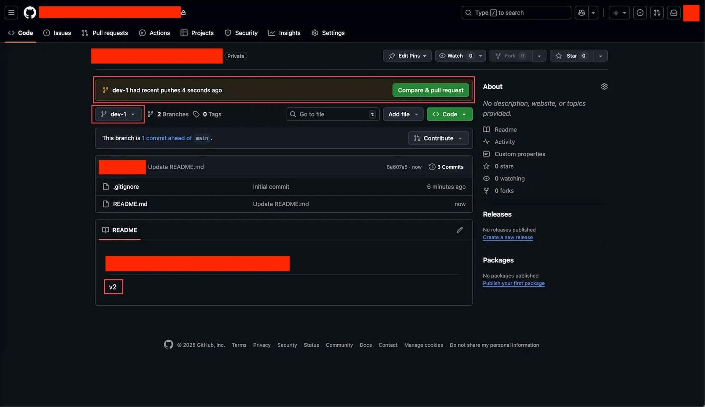
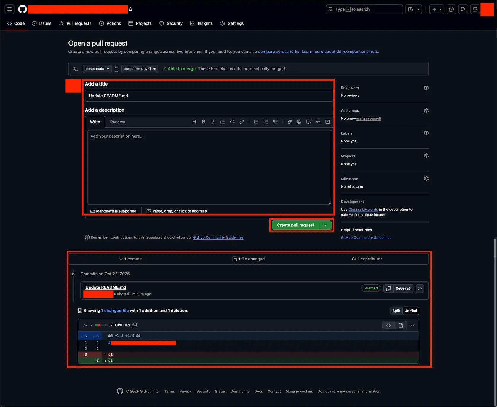
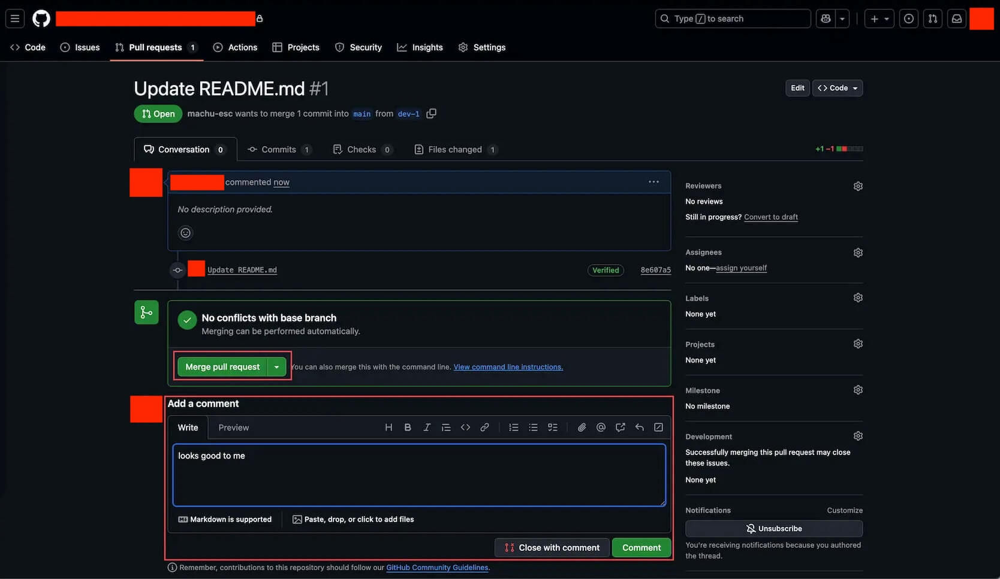

# Pull Request: 把分支成果合并回主线

> 本节教你用 Pull Request 把上一节在 dev-1 分支上完成的工作正式合并回 main 分支.

## 1. 概览

在上一节 (03 Working with Git Branch), 你在自己 repo 的 main 上加了 v1, 然后创建了 dev-1 分支并把内容改成了 v2. 现在 dev-1 上的工作已经完成, 效果也不错, 是时候把它合并回 main 了. 平行宇宙不能永远平行, 分支上做出来的成果, 最终要整合到主线, 才算是项目正式的一部分. 本节就带你走完这个流程, 用 GitHub 上的 Pull Request 把 dev-1 合并回 main.

---

## 2. 学习目标

上一节你学会了创建 Branch, 在一个独立分支上安心工作, 不影响 main. 但分支的价值不在于永远隔离, 而在于最终能把成果汇入主线. 如果做完的工作一直留在分支上, 它就永远不是项目的正式部分, 别人也用不上. Merge 就是解决这件事的动作: 把分支上验证过的改动, 应用回主分支. 在 GitHub 上, 我们通过 Pull Request (简称 PR) 来发起并完成这个合并. Pull Request 字面意思是 "拉取请求", 你可以理解成一句话: 我完成了一些工作, 请求把成果合并到主分支.

学完这个 Task, 你将能够:

1. 用自己的话解释 Merge 和 Pull Request 分别是什么, 以及它们的关系.
2. 看懂一个 PR 的合并方向: 分清 source (compare) 和 target (base), 一眼确认改动是从谁合并到谁.
3. 在自己的 repo 里为 dev-1 分支创建一个 Pull Request, 填好标题和描述.
4. 完成合并, 把 dev-1 的 v2 改动整合进 main, 并验证结果.
5. 理解什么是 Conflict (冲突), 以及为什么本节练习里你不会遇到它.

---

## 3. 前置知识

- 已完成上一节 (03 Working with Git Branch): 在自己 repo 的 main 上加了 v1, 创建了 dev-1 分支并把内容改成 v2.
- 会用浏览器登录你的 GitHub 账号, 并能在 repo 里切换分支.

---

## 4. 你将构建或学到什么

你将在自己的 repo 里, 把 dev-1 分支上的改动通过一个 Pull Request 合并回 main. 完成后, main 分支上的 README 会从 v1 变成 v2, 两个平行的分支合二为一. 你还会得到一条完整的合并记录: 一个带标题和描述的 PR, 一次 Merge, 以及 main 上更新后的内容. 这就是你在 GitHub 上完成的第一次分支合并.

---

## 5. Merge 是什么

延续博客的例子. 你在一个叫 try-new-style 的分支上试了新的写作风格, 折腾了好几天, 效果非常好, 现在想把这个新风格的版本应用到 main. 这个 "应用" 的过程, 就是 Merge (合并).

技术上, Merge 做的是三件事:

1. 找出差异: 对比两个 Branch, 看看它们之间有什么不同.
2. 打包改动: 把你在一个 Branch 上做的所有改动打包在一起.
3. 应用改动: 把这些打包好的改动, 应用到目标 Branch 上.

说白了, Merge 就是把一个分支上的成果, 搬到另一个分支上去.

---

## 6. Pull Request 是什么

Pull Request 是在 GitHub 上发起 Merge 的方式. 一个标准的 PR 流程是这样的:

1. 你在自己的分支上完成工作.
2. 你创建一个 PR, 说明自己做了什么, 请求把成果合并到主分支.
3. 在团队里, 其他人会审查你的代码, 提出意见.
4. 确认没问题后, 点 Merge 按钮, 正式完成合并.

在本节练习里, 因为是你自己的仓库, 审查和合并这两步都由你自己来做. 但流程本身和团队协作是一样的, 先理解流程, 以后进团队就不陌生了.

还有一个概念一定要刻进脑子: 合并永远有方向. 每个 Pull Request 都牵涉两个分支, 一个是 source (改动的来源, GitHub 在 PR 里管它叫 compare), 一个是 target (改动要合并进去的地方, GitHub 管它叫 base). PR 页面顶部会用 "base: <target> 从 compare: <source> 合并过来" 这样的形式, 明确写出这次合并是从谁到谁. 看任何一个 PR, 第一眼就该盯住这个方向, 确认它没搞反. 最常见的规律是: 一个名字很具体的分支 (比如 dev-1, alice-login, feature-search) 合并进一个名字很标准的主分支 (通常就是 main). 也就是说, 改动总是从具体的功能分支流向标准的主线. 一旦方向反了, 你就会把 main 的内容并进功能分支, 那通常不是你想要的. 本节你要做的这次合并, 方向就是从 dev-1 (source) 到 main (target).

---

## 7. 一个完整的工作流程

把 Commit, Branch, Merge 串起来看, 一个典型的功能开发流程是这样的:

- 起点: main 分支上只有 Commit 1, 内容是 "项目初始文件".
- 开分支: 从 Commit 1 分出一个 feature-search 分支, 用来开发搜索功能.
- 在分支上连续提交: 在 feature-search 上依次做 Commit 2 "添加搜索框", Commit 3 "实现搜索逻辑", Commit 4 "完善搜索功能". 这段时间里, main 还停在 Commit 1 没动.
- 合并回主线: 功能开发完成后, 把 feature-search 合并回 main. 这会产生一个 Merge commit, 它包含了 Commit 2, 3, 4 的所有改动. 现在 main 也有了完整的搜索功能.
- 收尾: feature-search 的使命已经完成, 可以删除了.

你在本节要做的, 正是这个流程里 "合并回主线" 这一步: 把 dev-1 合并回 main.

---

## 8. 实战第一步: 创建 Pull Request

先确保你当前在 dev-1 分支上. 如果不确定, 用页面上的分支切换器确认一下.

打开 repo 页面, 如果你刚刚在 dev-1 上做过改动, 页面顶部会出现一条黄色提示, 内容类似 "dev-1 had recent pushes X seconds ago", 旁边有一个绿色的 "Compare & pull request" 按钮. 点它就能直接进入创建 PR 的页面.

如果没看到这条黄色提示也不要紧. 你可以点仓库顶部的 "Pull requests" 标签, 再点绿色的 "New pull request" 按钮, 手动选择要合并的分支.

---

## 9. 实战第二步: 填写 PR 信息

进入创建页面后, 页面标题是 "Open a pull request". 这里有几处要看清.

**对比信息**: 页面上方会显示合并的方向, 形如 base: main 从 compare: dev-1 合并过来. 对照上一节讲的方向概念, 这里 target 是 main, source 是 dev-1, 方向没错, 就是把 dev-1 的改动并进 main. 旁边如果有一个绿色的勾和 "Able to merge" 字样, 表示这次合并可以自动完成, 没有冲突.

**标题 (Add a title)**: GitHub 会默认用你最后一次 Commit 的消息作为标题, 比如 "Update README.md". 你可以保持默认, 也可以改成更有描述性的说法.

**描述 (Add a description)**: 这里可以说明这个 PR 具体做了什么. 简单的练习可以留空, 也可以写一句, 比如 "将版本从 v1 更新到 v2".

**改动预览**: 页面底部会展示这次 PR 包含的所有改动. 你会看到红色背景的 `- v1` 表示删除, 绿色背景的 `+ v2` 表示新增. 这让你在合并前就能清楚看到合并后会发生什么.

确认无误后, 点绿色的 "Create pull request" 按钮.

---

## 10. 实战第三步: 合并 PR

创建成功后, 页面会跳到这个 PR 的详情页. 标题类似 "Update README.md #1", 其中 #1 表示这是你仓库里的第一个 PR.

你会看到一个绿色的 "Open" 标签, 表示 PR 正在等待处理. 下面还有 "No conflicts with base branch" 和 "Merging can be performed automatically", 说明可以放心自动合并. 再往下是一个绿色的大按钮 "Merge pull request", 按钮下方还有一个 "Add a comment" 区域, 可以留评论, 这一步是可选的.

执行合并: 点绿色的 "Merge pull request", 按钮会变成 "Confirm merge", 再点一次确认.

合并完成! 你会看到一个紫色的 "Merged" 标签, 页面会显示这次合并了多少个 commit 到 main. 同时出现一个 "Delete branch" 按钮. 你可以点它, 删除已经合并完的 dev-1 分支, 保持仓库整洁. 删分支不会丢数据, 因为改动已经进入 main 了.

---

## 11. 实战第四步: 验证合并结果

合并做完了, 最后一步是确认成果真的进了 main.

1. 点仓库名, 回到 repo 主页.
2. 确认当前在 main 分支上 (分支切换器显示 main).
3. 查看 README 的内容.

现在 README 显示的应该是 v2 了. 这意味着 dev-1 上的改动已经成功合并到 main, 两个平行宇宙合二为一.

---

## 12. 关于 Conflict

如果两个人同时改了同一个文件的同一行, 合并时会怎样? 这时会产生 Conflict (冲突).

**什么时候发生**: 举个例子, 你在 branch-A 里把某一行改成 "Hello World", 你的同事在 branch-B 里把同一行改成 "Hi World". 你们都想合并到 main, Git 就懵了, 它不知道该用哪个版本. 这时 GitHub 会提示有冲突, 无法自动合并.

**如何解决**: GitHub 会弹出一个文本编辑框, 让你手动决定保留哪个版本, 或者两个都保留, 或者写一个全新的版本. 冲突解决的细节很多, 这里不展开, 你现在只需要记住三点:

- 冲突是正常的, 它不是错误.
- 当 Git 无法自动决定时, 它会请人类来决定.
- 大多数情况下, 如果大家改的是不同文件或不同行, 就不会有冲突.

在本节练习里, 只有你一个人操作, 所以你不会遇到冲突.

---

## 13. 回顾: 我们学到了什么

- Merge 是把一个分支上的改动应用到另一个分支, 做的是找差异, 打包改动, 应用改动三件事.
- 合并有方向: 从 source (compare) 到 target (base), PR 顶部会写明; 常见规律是具体的功能分支合并进标准的 main.
- Pull Request 是在 GitHub 上发起合并的方式, 流程是创建, 审查, Merge, 删除分支.
- 完成了实战: 为 dev-1 创建 PR, 填好标题描述, 合并, 并验证 main 上的 README 变成了 v2.
- 理解了 Conflict 是同一位置的不同修改导致的, 需要人工决定, 而单人操作不会遇到.

---

## 14. 导师寄语

**为什么这个练习重要:**

到这一步, 你已经掌握了 Git 的完整核心工作流: Commit, Branch, Merge. 这三个动作是 Git 的骨架, 几乎所有协作都建立在它们之上. 想象一个 10 人的团队, 每个人在自己的分支上工作, 完成后通过 PR 提交审查, 其他人看过提建议, 通过后再 Merge 到 main. 正是这套流程, 让复杂的协作变得井井有条.

**关键洞见:**

- Pull Request 不只是一个技术操作. 它是代码审查的载体 (同事可以在 PR 里留评论指出问题), 是知识分享的窗口 (审查别人的 PR 能学到很多), 也是质量保证的关口 (很多团队要求 PR 必须经过审查才能合并). 所以学会写清晰的 PR, 好标题, 清楚的描述, 合理的改动范围, 是一项重要的职业技能.
- 勤于 Merge, 保持同步. 不要让一个分支独立太久, 否则它和 main 的差异越来越大, 最后合并时会冒出一堆冲突. 更好的做法是频繁把 main 的更新同步到工作分支, 每完成一小部分就合并回 main. 小步快跑, 比憋一个大招高效得多.

**下一步:**

在真实项目里, 养成用 PR 提交工作的习惯, 哪怕只有你一个人. 每个 PR 都是一段清晰的工作记录, 未来的你会感谢现在认真写描述的自己.

---

## 15. 速查

**创建并合并 PR 的完整流程:** 确认在 dev-1 分支, 点黄色横幅里的 "Compare & pull request", 填好标题和描述后点 "Create pull request", 在详情页点 "Merge pull request" 再点 "Confirm merge", 最后切回 main 确认 README 变成 v2.

**关键概念:**

- Merge: 合并分支, 把一个分支的改动应用到另一个分支.
- 合并方向: source (compare) 到 target (base), 看 PR 顶部的 base 从 compare 那一行确认; 一般是功能分支到 main.
- Pull Request: 合并请求, 在 GitHub 上发起并完成合并.
- Conflict: 冲突, 同一位置的不同修改, 需要人工决定保留哪个.

**关键文件:**

- `README.md`: 本节合并的目标文件, 合并后它在 main 上会显示 v2.

---

## 16. 参考实现

本节没有需要运行的代码. 参考成果就是: 你的 repo 里有一个已合并的 PR (带紫色 Merged 标签), main 分支上的 README 显示 v2, 且 dev-1 上的改动已经全部进入 main.
