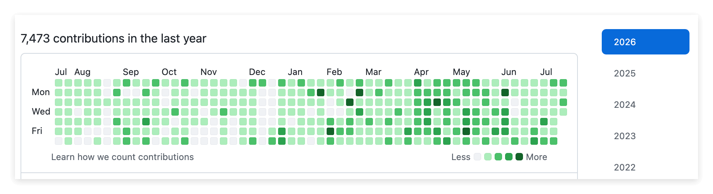
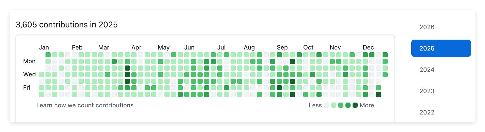
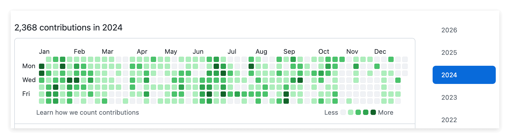
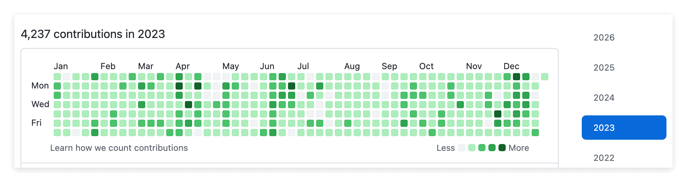
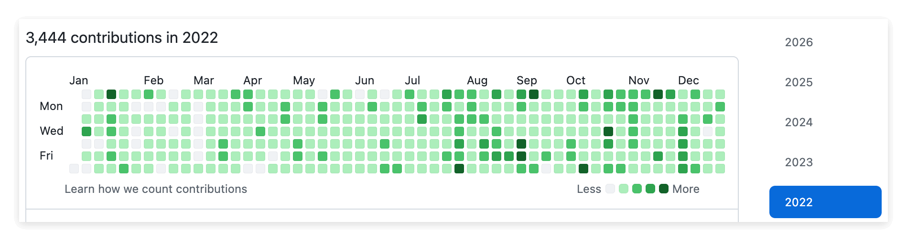

# Put Everything on GitHub

> This lesson has no code. It is about making one shift in mindset: from today on, put everything you do on GitHub.

## 1. Overview

Congratulations on reaching the final lesson of this course. In the first four lessons you learned how to create a repo, edit files in the web interface, use a branch, and merge a branch. Those are real, concrete skills. But this lesson gives you something different. It may be the single most important mindset shift in the whole course.

The shift is simple: from today on, put everything you do on GitHub. Not just code, but also notes, homework, documents, and AI-generated drafts. All of it. This is not a programmer thing. It is about how to leave yourself a permanent, verifiable record that nobody can fake, in the age of AI.

---

## 2. Learning Goals

In the age of AI, the labels a person puts on themselves are worth less and less. Resumes get padded, portfolios get fabricated, and AI can churn out piles of impressive-sounding work you never actually did. So how do you prove you are the real deal? The answer is time. A record that builds up day after day, week after week, month after month is something nobody can forge. And GitHub is the one platform that makes keeping that kind of long-term record effortless. That is exactly why it is worth building the habit right now.

By the end of this Task, you will be able to:

1. Explain why GitHub is better than Word and Google Docs for managing documents.
2. Understand what a GitHub contribution graph is, and what it means for your career.
3. Understand why GitHub plus AI is fundamentally more powerful than any AI assistant built into a single app.
4. Commit to making GitHub a daily habit.

---

## 3. Prerequisites

- You have finished lessons 01 through 04 of this course. You can create a repo, edit files in the web interface, use a branch, and merge a branch.
- You have a GitHub repo of your own that you created during this course.

---

## 4. What You Will Build or Learn

This lesson has no code. What it builds is a habit. By the end you will have a clear plan for moving your daily work onto GitHub, and a deep understanding of why this matters more than any single technical skill.

---

## 5. The Problem With Word and Google Docs

Look at how most people manage documents today. You write a document in Word, revise it ten times, email it to someone, they revise it too, and then nobody can tell which version is the latest. Google Docs is a little better because several people can edit at the same time, but when you change something, the old version effectively "disappears." Yes, it keeps a version history, but nobody ever goes digging through it. Your work record is hidden, unstructured, and trapped inside one app.

GitHub does it completely differently:

- Every change is a commit, a permanent, time-stamped record.
- You can see exactly what changed, when it changed, and why it changed.
- Your work history is structured, and it can be public or private.
- Nothing ever disappears. The full history is always there.

At its core, information is just text. Word wraps text in a proprietary format, Google Docs wraps text in a web app, and GitHub manages text in its purest form, adding version control, collaboration tools, and a permanent audit trail on top. Going back to the most fundamental thing is often what makes something the most powerful.

---

## 6. Why GitHub Plus AI Is Far More Powerful

Google Docs has Gemini built in. It can summarize a document, suggest edits, and answer questions. That sounds great, but it has one fundamental limitation: Gemini only knows the one document it is currently looking at. It does not know your other files, your project history, your codebase, your notes, or the decisions you made earlier. Every time, you have to explain the background from scratch.

On GitHub, the situation is completely different:

- AI tools can see your entire repo, every file, all the history, all the branches.
- They can read your commit messages and understand how your thinking evolved over time.
- You can write scripts and automation, which you cannot do in Google Docs.
- Assistants like GitHub Copilot and Claude Code can work with the context of your whole project.

Here is an analogy: an AI that can only see one document is like a consultant who wakes up with amnesia every morning. An AI that can see your entire repo is like a teammate who has worked alongside you since day one. The difference is not incremental. It is orders of magnitude.

---

## 7. A Wall of Green, Your Best Resume

Open any GitHub user's profile and you will see a grid of little green squares. One square for each day of the year, and each square represents that day's contributions, such as commits, pull requests, code reviews, and so on. The more contributions, the darker the green. This is the contribution graph, and people often just call it "the wall of green."

The graph looks very different from one person to the next:

- A beginner student's graph is mostly gray, with only a few scattered green dots.
- A working engineer has some green, dense when they are busy and sparse when they are not.
- A senior engineer or an active open source contributor has a screen full of deep green, building, reviewing, and improving almost every single day.

When a hiring manager looks at your profile, this graph tells a story that no resume can match: this person does the work every day, not just talks about it, but actually keeps building.

Below is one active developer's contribution graph across five straight years. You can feel at a glance what "a screen full of deep green" means: every year is packed tight, thousands of contributions per year, one year after another without a break. This kind of record, built up over time and impossible for anyone to forge, is the most convincing resume there is.

Let us do the math so you can see what those hundreds or thousands of contributions really mean. A year has 365 days, but the days you actually do real work are only about 200. As long as you keep a normal rhythm on your working days, committing at least once a day (some days you are in meetings, some days you barely touch the keyboard, but some days you fire off a dozen commits in one sitting), you will easily rack up ten-plus contributions in a week. Multiply that across 52 weeks and a few hundred a year is the bare minimum.

So flip it around: if someone cannot even scrape together a few hundred contributions in a whole year, what does that tell you? It tells you they have basically not been building, not been learning, not been improving themselves. Almost everything new and cutting-edge in the world lives on GitHub, and if you leave no trace there, chances are you simply have not touched any of it. The contribution graph does not lie. It honestly records whether or not you have actually been putting in the work.

Here is an important note: you can click any green square and see exactly what that person committed that day, every change, every file, every line of code, laid out in plain sight. That is why faking it does not work. If someone has a wall of green but you click in and find that each commit just adds a blank space, you can see through it instantly. That is faking, not a contribution history.

---

## 8. Building Your Wall of Green the Right Way

A wall of green is not something you game your way into. There are things you should absolutely never do:

- Making meaningless commits just to turn a square green.
- Editing the same file over and over with trivial, pointless changes.
- Using a script or bot to auto-commit empty changes.

These are obvious at a glance. Click the square, and the commit details are right there for anyone to see. If it is all "fix typo" followed by "fix typo again," it gets flagged as fake, which is worse than having no record at all.

Here is what you should do instead:

- Put your class notes on GitHub, so each study session is a commit.
- Put your homework and documents on GitHub, so every edit is tracked.
- Put your AI-generated documents on GitHub, keeping the draft, the revisions, and the final version.
- Put your project code on GitHub, and the key is to keep at it.

The core idea is that you do not need to do any extra work. You are already learning, writing, and building projects. You just do it in a different place, on GitHub instead of in Word, and the green squares appear on their own. Let it happen naturally. No need to force it.

---

## 9. GitHub Is Not Just for the Science and Engineering Crowd

There is a common misconception that only programmers use GitHub. That idea is out of date. At its core, GitHub is a text management system with version control, and anything you can express in words can go on it:

- Meeting notes and agendas.
- Research reports and papers.
- Project plans and task lists.
- Study notes and learning logs.
- Team collaboration documents.
- Data analysis notebooks. Jupyter Notebooks render beautifully on GitHub.

In the age of AI, GitHub is the most efficient way to manage information and leave a record, no matter what field you are in. A lawyer can keep case notes, a marketing manager can manage multiple versions of a campaign plan, a student can organize coursework. Everyone benefits from the same principles: version control, transparency, and permanence.

---

## 10. Exercises

### Exercise 1: Explore Your Contribution Graph

**Goal:** See what a real contribution graph looks like, and what it can reveal.

**How to do it:**

1. Open your own GitHub profile, click your avatar in the top right, and choose Your profile.
2. Scroll down and find the contribution graph.
3. Count how many green squares you have so far. After doing the exercises across all these lessons, you should already have a fair number.
4. Click one of the green squares and see what you committed that day.
5. Go look at the public profile of an experienced developer or an active open source contributor.
6. Compare your contribution graph with theirs, and notice the difference in density and consistency.

**What you will observe:**

Your graph has a few green dots from this course's exercises, while theirs is far greener. That gap is not talent. It is habit.

> **Key insight:** Every commit you made in this course already shows up on your contribution graph. You are already building a record. You just need to keep going.

### Exercise 2: Move a Document to GitHub

**Goal:** Practice managing a non-code document on GitHub.

**How to do it:**

1. Think of a document you wrote recently in Word or Google Docs, class notes, homework, anything at all.
2. Open your own repo.
3. Create a new file with a meaningful name, such as notes/2026-04-13-class-notes.md.
4. Copy the content of your Word or Google Doc into it. Formatting it in Markdown is even better, but plain text is perfectly fine too.
5. Write a meaningful commit message, such as Add class notes from April 13 lecture.
6. Commit the file.

**What you will observe:**

This document now has a permanent home, and it is version controlled. Edit it again tomorrow and the history is preserved, and your contribution graph gains one more green dot.

> **Key insight:** The whole process takes less than two minutes, yet it creates a permanent, verifiable record of your work. That is the power of making GitHub your default work environment.

---

## 11. Recap: What We Learned

- Word and Google Docs are convenient to use, but they do not leave a lasting, structured record.
- GitHub turns every edit into a permanent, time-stamped, verifiable contribution record.
- The contribution graph is visual proof of your consistency, and no resume can copy that kind of persuasiveness.
- GitHub plus AI is fundamentally more powerful than single-document AI, because it has the full project context.
- You do not need extra effort. You just do the things you were already doing, in a different place.
- GitHub is not just for writing code. It is the best tool for managing all text-based information in the age of AI.

Going from "I use GitHub to turn in my code homework" to "I use GitHub for everything" takes very little effort, but the impact is huge.

---

## 12. This Is Not the End, but the Start of a Through-Line

By reaching this point, "Learn GitHub Basics" has finished laying the foundation, but this is far from the end. More accurately, you have just stepped onto a through-line that will run through your entire career.

The real name of this through-line is not GitHub, and it is not Git. It is this: use a system with version control and a full history to accumulate all of your work. What happens to carry this through-line today is Git plus GitHub. They are convenient, free, and used all over the world. But even if GitHub ceased to exist one day (which, for the foreseeable future, is almost impossible), another system would surely take its place. The tools change, but the principle does not: the record of your work that you leave day after day, time-stamped, traceable, and impossible for anyone to fake, is the most solid proof of who you are.

In the age of AI, this only becomes more important. So do not treat these five lessons as "I finished learning a piece of software." What you are really starting to build is a habit and an asset that will follow you for many years. Later courses keep moving forward, teaching you how to control visibility, how to collaborate with others, and how to use this through-line more professionally. But from today on, the through-line is already beneath your feet.

---

## 13. A Note From Your Mentor

**Why this exercise matters:**

This may be the highest-value lesson in the whole course, even though it has almost no technical content. I have seen this happen far too often: a student learns Git, branches, and how to push code, then turns right around and writes everything in Word, treating GitHub as "a tool for writing code" and missing the bigger picture. The bigger picture is this: in the age of AI, your ability is no longer defined by what you claim to know, but by what you can prove you have done, and GitHub is the one platform that can provide undeniable, time-stamped proof.

**Key insights:**

- A wall of green on your profile is more convincing than any single line on a resume.
- The real power of GitHub is not version control, it is context. When AI can see your entire project history, its capabilities go up by orders of magnitude.
- Building this habit costs almost nothing extra.
- This applies to everyone, not just developers.

**Next step:**

From today on, before you open Word or Google Docs, ask yourself one question: could I do this on GitHub instead? The answer is almost always yes. Make the switch, and let the green squares accumulate naturally. Six months from now, your GitHub profile will be the most convincing thing on your resume.

---

## 14. Quick Reference

**Daily habit:** Open your repo, do your thing (notes, homework, documents, code), commit with a meaningful commit message, done, green square earned.

**Key links:**

- Your GitHub profile, https://github.com/YOUR-GITHUB-USERNAME-HERE, for viewing your contribution graph.
- The list of all your repos, https://github.com/YOUR-GITHUB-USERNAME-HERE?tab=repositories, your way into your own repo, the home base for all of your work.
