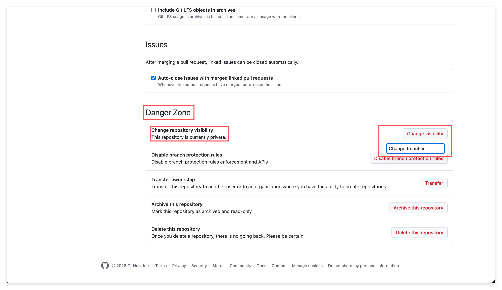

# 创建 Private Repository: 守住你的安全边界

> 学会创建只有你和你邀请的人能看到的 Private Repo, 并搞清楚什么该公开, 什么必须私有.

## 1. 概览

这是 "Learn GitHub Basics" 系列的第六节. 前面五节里, 你练习用的一直是 Public Repo, 图的是省心, 不用操心权限和邀请. 这一节我们换一个开关: 创建 Private Repository, 也就是只有你自己 (以及你显式邀请的人) 才能看到的仓库.

有意思的地方在于, Public 和 Private 看上去只是创建时的一个选项, 但它背后是两条很重要的边界: 一条是隐私 (谁能看到你的东西), 一条是安全 (什么东西绝对不能被全世界看到). 这一节不写代码, 但它教你的判断力, 可能比任何一个具体操作都更重要.

---

## 2. 学习目标

先想两个场景. 第一个: 你要把自己的报税单, 或者一份还没定稿, 不想被人围观的调研, 交给 AI 帮你整理. 这些资料你绝不希望全世界都能搜到. 第二个: 你图方便, 把一段含有密码的配置直接写进了一个文件, 提交, 推到了一个 Public Repo 上, 几分钟后, 它就可能被人扫到了.

这两个场景的共同点是: 分不清 public 和 private, 代价可能是隐私泄露, 甚至一次真实的安全事故. 而这一切, 只取决于你创建 repo 时那一个选项选对没选对. 这就是为什么值得专门用一节课, 把这条边界讲透.

学完这个 Task, 你将能够:

1. 独立创建一个 Private Repository.
2. 用匿名窗口验证 private repo 对外不可见, 并认得页面上的 Private 标记.
3. 判断一份内容该放 public 还是 private, 并在创建 repo 之前就想清楚.
4. 说清楚为什么 public 的东西一旦泄露就再也收不回, 以及如何在 Settings 里切换 visibility.

---

## 3. 前置知识

- 已经完成本课的 01 到 05 节, 会创建 repo, 会在网页端编辑和 commit 文件.
- 一个可以正常登录的 GitHub 账户.
- 一个现代浏览器, 并且知道怎么打开它的匿名窗口 (无痕模式).

---

## 4. 你将构建或学到什么

完成这一节后, 你会拥有一个真正只有你能看到的 Private Repo, 并且亲手验证过 "别人真的看不到它". 但比这个仓库更重要的, 是你会建立一个创建 repo 前的条件反射: 先停一秒, 问自己一句, 这东西该 public 还是 private.

---

## 5. Public 和 Private 的本质区别

visibility (可见性) 只有两个选项, 但它决定了你的内容是面向 "全世界" 还是 "只有自己".

- Public: 地球上任何人, 哪怕从没登录过 GitHub, 都能看到这个 repo 的全部内容. 你在 01 节用匿名窗口已经亲眼见过这一点.
- Private: 只有你, 以及你显式邀请进来的人, 才能看到. 对其他所有人来说, 这个 repo 就像不存在一样, 连它的 URL 都打不开.

同一个仓库, 唯一的差别就是这个开关. 而且 GitHub 会在页面上明确标出来: public 仓库名旁边是一个 Public 标记, private 仓库名旁边是一个 Private 标记. 养成看一眼这个标记的习惯, 你就永远不会搞错自己正在往哪种仓库里放东西.

---

## 6. 什么时候该用 Private

先给一个默认心智. 如果你在做的是纯学习, 纯练习, 或者一个你想拿去当作品集给人看的项目, 那就用 public, 开放本身能带来协作和背书. 前五节我们一直用 public, 就是这个道理.

但一旦这个 repo 里要装的是 "不适合别人看的东西", 就该切到 private. 典型的几类:

- 功课, 还没定稿的调研, 你不想被人围观的半成品.
- 私事: 个人财务, 报税单, 政府文件这类你想接入 AI 帮你处理, 但绝对不能外流的资料.
- 任何私密的写作, 日记式的笔记, 还没公开的内部方案.
- 公司或团队的内网资料, 内部代码, 商业机密, 这类几乎永远是 private.

一句话总结这个习惯: 在你点下 Create repository 的那一刻, 心里就要有数, 这是 public 还是 private. 别等到东西已经写进去, 甚至已经推上去了, 才想起来后悔.

---

## 7. 动手创建一个 Private Repo

好消息是, 创建流程和 01 节几乎一模一样, 你已经会了. 唯一的关键区别只有一处: visibility 这次选 Private.

1. 点右上角头像旁的 "+" 号, 选 New repository (和 01 节完全一样).
2. 填 Repository name, 起一个能看出它是私有练习的名字, 比如 john-doe-private-notes.
3. Choose visibility: 这一次, 选 Private.
4. 勾选 Add a README.
5. 点击底部绿色的 Create repository.

创建完成后, 留意仓库名旁边的标记: 这次应该是 Private, 而不是 01 节里的 Public. 这一节我们不提供截图, 因为界面和 01 节几乎没有区别, 你照着做一遍就会发现, 真正变的只有 visibility 这一个选择.

---

## 8. 验证它真的对外不可见

还记得 01 节的练习 2 吗? 你复制自己 public repo 的 URL, 在匿名窗口里打开, 未登录也能看到它. 现在, 我们对这个新的 private repo 做完全一样的动作, 看看结果有什么不同.

1. 复制这个新 private repo 的 URL, 形如 https://github.com/USERNAME/REPO_NAME.
2. 打开浏览器的匿名窗口. 匿名窗口里没有你的登录状态, 相当于一个从没登录过 GitHub 的陌生人, 用它来模拟 "全世界".
3. 把 URL 粘贴进去, 回车.

这一次, 你看到的不是你的 repo, 而是一个 404 (Not Found) 页面. 注意 GitHub 的处理方式很讲究: 它对没有权限的人干脆假装这个 repo 根本不存在, 连 "存在但你无权访问" 都不告诉对方. 这就是 private 的含义, 对全世界隐身. 而当你回到正常的, 已经登录的窗口再打开它, 一切正常, 顶部还有个 Private 标记时刻提醒你, 这是个私有仓库.

把 01 节和这一节的两次匿名窗口实验放在一起看, 你就彻底理解了这个开关: public 是 "全世界都能看", private 是 "全世界都看不到".

---

## 9. 一条严肃的安全警告: 别把 secret 提交上去

GitHub 上有海量好东西, 但也正因为如此, 它是黑产的狩猎场. 有自动化脚本 7 天 24 小时不停地扫描全网新创建, 新提交的 public repo, 专门找有价值的 secret: 数据库密码, API key, 云服务凭证, 甚至加密货币钱包的私钥.

学生里最常见的一类事故就是: 图方便, 把密码或密钥直接硬写进某个文件, 提交, 推上一个 public repo. 从你推上去, 到它被扫到, 可能只隔几分钟. 我不是在吓你, 这是每天都在真实发生的事.

所以请记住几条红线:

- 永远不要把密码, API key, token, 私钥这类 secret 写进任何将要 public 的文件.
- 真要处理这类敏感内容, 比如接入 AI 处理你的财务或私人资料, 就用 private repo.
- 心里绷一根弦, 提交之前想一下, 这个文件里有没有不该被全世界看到的东西.

---

## 10. Public 一旦泄露, 就再也收不回

private 之所以重要, 还有第二个更狠的理由: public 的东西是可以被无限复制的, 而一旦复制出去, 你就再也删不掉了.

- GitHub 上任何 public repo, 别人都能一键 Fork. Fork 你可以理解成 "把你的仓库克隆一份镜像到他自己名下", 从那一刻起, 那份副本就和你没关系了, 你管不着也删不了.
- 一旦你的内容以 public 的形式泄露出去, 满世界的人和自动化机器人会争相 fork, mirror, 留备份. 你就算马上删掉原始 repo, 也删不掉别人手里那无数份副本. 它已经扩散出去了.

举一个真实的, 而且发生在最顶尖的公司身上的案例. 2026 年 3 月, 就连 Anthropic 自己, 都因为一个打包时的疏忽 (漏配了一个叫 .gitignore 一样作用的 .npmignore), 把 Claude Code, 也就是当时最强的 coding agent 之一, 大约 51 万行完整源码, 打进了一个公开的 npm 包里发了出去. 几个小时之内, 这份代码就被 mirror 到了 GitHub, 有的仓库瞬间涨到 8 万多个 star 和 fork, 由它衍生出的项目一天之内冲上 10 万 star, 成了 GitHub 历史上增长最快的仓库之一. 更糟的是, 还有人往这些副本里塞恶意软件, 去坑那些来围观下载的人. 事情一旦发生, 就是收不回来的, 连世界顶级的团队, 靠法律手段也压不住.

这个故事的教训不是 "别人会犯错", 而是: public 意味着不可逆的扩散. 所以凡是你还拿不准, 或者已经明确敏感的东西, 先 private. 想公开随时能改, 但一旦公开出了事, 就没有后悔药.

---

## 11. Public 和 Private 可以随时互相转换

visibility 不是一次性的决定, 选错了或者情况变了都能改, 只是入口藏得有点深.

在这个 repo 里点顶部的 Settings, 再点左侧边栏的 General, 你就来到了仓库的总设置页.

然后在这个页面里一直往下滚, 滚到最底部的 Danger Zone (危险区). 在那里你会看到 Change repository visibility 这一项, 点右边的 Change visibility 按钮, 就能选择切换方向.

从这里:

- 可以把一个 private repo 改成 public.
- 也可以把一个 public repo 改成 private.

两个方向都支持. 但要注意一个不对称的地方: 把 public 改成 private, 你可能会失去这个 repo 积累起来的社区数据, 比如 star, watcher, fork, 因为这些数据本来就来自 "它是公开的" 这件事. 反过来, 把 private 改成 public 一般不会有这种损失.

它被放在 Danger Zone 是有道理的: 改可见性影响面很大, GitHub 特意把它和 "删除整个 repo" 这类操作放在一起, 逼你慎重对待. 你不用背下具体每一步, 记住入口就行: Settings, General, 拉到最底部的 Danger Zone.

---

## 12. 练习

### 练习 1: 创建一个 Private Repo 并验证它隐身

**目标:** 亲手创建一个 private repo, 并用匿名窗口确认全世界真的看不到它.

**怎么做:**

1. 按第 7 节的步骤新建一个 repo, Repository name 起个类似 john-doe-private-notes 的名字.
2. 关键一步: Choose visibility 选 Private, 并勾选 Add a README, 然后 Create repository.
3. 创建后, 确认仓库名旁边显示的是 Private 标记.
4. 复制这个 repo 的 URL, 打开浏览器的匿名窗口, 把 URL 粘贴进去回车.

**你会观察到:**

在匿名窗口里, 你看到的是一个 404 页面, 而不是你的 repo, GitHub 对没权限的人假装它不存在. 回到已登录的正常窗口再打开, 一切正常, 顶部有 Private 标记. 这正好和你在 01 节看到的 public 行为相反.

> **关键洞见:** private 不是 "藏起来一点点", 而是对全世界彻底隐身. 需要私密时, 这就是你的默认选择.

### 练习 2: 在 Danger Zone 里切换一次可见性

**目标:** 熟悉切换 visibility 的入口, 并亲眼看到标记随之变化.

**怎么做:**

1. 打开你刚创建的这个练习用的 private repo (选它是因为切换它没有任何风险).
2. 点 Settings, 进入 General, 一直滚到最底部的 Danger Zone.
3. 找到 Change visibility, 把它从 Private 改成 Public, 按提示确认.
4. 回到 repo 主页, 看仓库名旁边的标记, 是不是变成了 Public. 有兴趣的话, 再用匿名窗口验证一次, 这回应该能看到了.
5. 最后再回到 Danger Zone, 把它改回 Private.

**你会观察到:**

同一个 repo, 仅仅因为你翻动了 Danger Zone 里的这一个开关, 它对全世界的可见性就完全反转了. 标记从 Private 变成 Public 再变回来, 匿名窗口的结果也随之从 404 变成可见再变回 404.

> **关键洞见:** 可见性随时可改, 但方向是有代价的. 拿不准时先 private, 因为把 private 放开成 public 几乎没有成本, 而把已经公开出去的东西收回来, 往往为时已晚.

---

## 13. 回顾: 我们学到了什么

- visibility 只有 public 和 private 两个选项, 却决定了你的内容面向全世界还是只有自己.
- Public 任何人都能看到并 Fork; Private 对没有权限的人返回 404, 彻底隐身.
- 页面上的 Public 或 Private 标记, 是你随时确认自己在往哪种仓库放东西的最快方式.
- 默认心智: 学习和作品集用 public, 一旦涉及私密, 财务, 内部或敏感内容就用 private.
- 绝不要把密码, key, token, 私钥这类 secret 提交进 public repo, 有机器人专门扫这些.
- Public 意味着不可逆的扩散, 泄露了就再也收不回, 连顶级公司也压不住.
- 可见性在 Settings, General, Danger Zone 里可以互相切换, 但 public 转 private 可能丢掉社区数据.

---

## 14. 导师寄语

**为什么这个练习重要:**

我见过不少学生, 技术操作都会, 却栽在 "分不清 public 和 private" 这件最基础的事上. 有人把私人资料公开了自己都不知道, 有人把公司的密钥推上了公网. 这些都不是技术不行, 而是创建 repo 那一刻脑子里没有绷着这根弦. 所以这一节我真正想教给你的, 不是 "怎么点出一个 private repo", 而是一种默认的谨慎: 在东西进入仓库之前, 先想清楚谁该看到它.

**关键洞见:**

- 可见性是一条边界, 不是一个细节. 选错的代价, 可能远大于你在这个 repo 里做的任何具体工作.
- public 的力量在于传播, private 的价值在于控制. 好的判断力, 就是知道当下需要哪一个.
- 安全上最省事的做法是把默认设成谨慎: 拿不准就先 private, 想公开随时能放开; 反过来却常常来不及.

**下一步:**

private repo 会立刻带来一个新问题: 既然除了我别人都看不到, 那我想让一个特定的同学, 同事或协作者进来一起弄, 又不想对全世界公开, 该怎么办? 这正是下一节的主题, 给 repo 添加 collaborator (协作者), 把 "看" 和 "改" 的权限精确地只发给你信任的那几个人. 换句话说, 你即将学会的是, 如何在 "只有我" 和 "全世界" 之间, 画出一个刚刚好的圈子.

---

## 15. 速查

**Public vs Private:** Public 任何人可见可 Fork; Private 只有你和被邀请的人可见, 对其他人返回 404.

**创建入口:** 右上角 "+" 号, New repository, 关键是 Choose visibility 选 Private.

**匿名验证:** 复制 repo URL, 在匿名 (无痕) 窗口打开. Public 能看到, Private 显示 404.

**切换可见性:** Settings, General, 拉到最底部 Danger Zone, Change visibility. 注意 public 转 private 可能丢失 star, watcher, fork.

**安全红线:** 密码, API key, token, 私钥这类 secret 绝不进 public repo; 敏感内容一律用 private.
