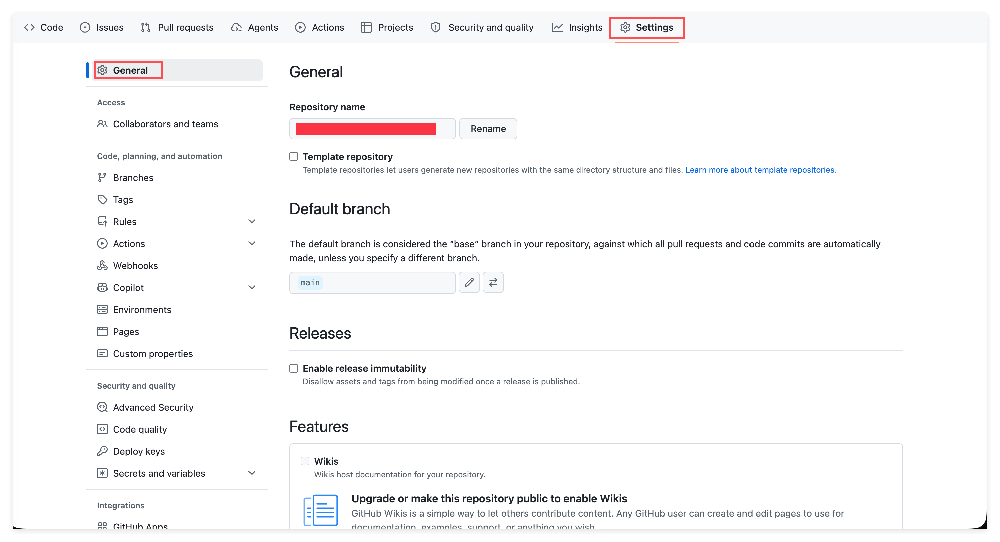

# Creating a Private Repository: Holding Your Security Line

> Learn to create a Private Repo that only you and the people you invite can see, and get clear on what should be public and what must stay private.

## 1. Overview

This is lesson 08 of the "Learn GitHub Basics" series. In the earlier lessons, you always practiced on Public Repos, and for good reason: they keep things simple, with no permissions or invitations to worry about. In this lesson we flip a different switch and create a Private Repository, a repo that only you (and the people you explicitly invite) can see.

Here is the interesting part. Public and Private look like nothing more than one option you pick at creation time, but behind that option sit two important boundaries: one is privacy (who can see your stuff), and the other is security (what must never be visible to the entire world). This lesson has no code in it, but the judgment it teaches may matter more than any single hands-on step.

---

## 2. Learning Objectives

Start by picturing two scenarios. First: you want to hand your tax return, or a piece of research that is not final and that you would rather nobody watched, to an AI to help you organize it. This is material you absolutely do not want the whole world to be able to search for. Second: for convenience, you drop a snippet of config that contains a password straight into a file, commit it, and push it to a Public Repo, and a few minutes later someone's scanner has already found it.

What these two scenarios share is this: failing to tell public from private can cost you your privacy, or even cause a real security incident. And all of it comes down to whether you got that one option right when you created the repo. That is exactly why it is worth spending a whole lesson to make this boundary crystal clear.

By the end of this Task, you will be able to:

1. Create a Private Repository on your own.
2. Use an incognito window to verify that a private repo is invisible to the outside world, and recognize the Private badge on the page.
3. Judge whether a piece of content belongs in public or private, and think it through before you even create the repo.
4. Explain why anything public can never be pulled back once it leaks, and how to switch visibility in Settings.

---

## 3. Prerequisites

- You have completed lessons 03 through 07 of this course, so you can create a repo and edit and commit files in the web UI.
- A GitHub account you can log into normally.
- A modern browser, and knowing how to open its incognito window (private mode).

---

## 4. What You Will Build or Learn

After finishing this lesson, you will own a Private Repo that truly only you can see, and you will have verified with your own hands that "nobody else can actually reach it." But more important than the repo itself is a reflex you will build for every time you create a repo: pause for one second and ask yourself, should this be public or private.

---

## 5. The Real Difference Between Public and Private

visibility has only two options, but it decides whether your content faces "the whole world" or "only yourself."

- Public: anyone on Earth, even someone who has never logged into GitHub, can see everything in this repo. You saw this with your own eyes back in lesson 03 using an incognito window.
- Private: only you, and the people you explicitly invite in, can see it. To everyone else, this repo might as well not exist; they cannot even open its URL.

The same repository, and the only difference is this one switch. GitHub also spells it out right on the page: a public repo has a Public badge next to its name, and a private repo has a Private badge next to its name. Get into the habit of glancing at that badge, and you will never be confused about which kind of repo you are putting things into.

---

## 6. When to Use Private

Start with a default mindset. If what you are doing is pure learning, pure practice, or a project you want to show off as part of a portfolio, then use public; openness itself brings collaboration and credibility. That is exactly why we used public in the earlier lessons.

But the moment this repo is going to hold "things that are not meant for others to see," you should switch to private. A few typical categories:

- Homework, research that is not yet final, half-finished work you do not want people watching.
- Personal matters: personal finances, tax returns, government documents, the kind of material you want to feed to an AI for help but that absolutely must not get out.
- Any private writing, diary-style notes, internal plans that have not been made public.
- Company or team intranet material, internal code, trade secrets; this kind of thing is almost always private.

To sum up the habit in one line: at the very moment you click Create repository, you should already know in your mind whether this is public or private. Do not wait until the content is already written in, or even already pushed up, to start regretting it.

---

## 7. Create a Private Repo Yourself

The good news is that the creation flow is almost identical to lesson 03, and you already know it. The one crucial difference is a single spot: this time you choose Private for visibility.

1. Click the "+" next to your avatar in the top right and choose New repository (exactly as in lesson 03).
2. Fill in the Repository name, picking a name that makes it obvious this is a private practice repo, for example john-doe-private-notes.
3. Choose visibility: this time, select Private.
4. Check Add a README.
5. Click the green Create repository at the bottom.

Once it is created, notice the badge next to the repo name: this time it should be Private, not the Public you saw in lesson 03. We do not provide screenshots for this lesson, because the interface is almost no different from lesson 03; walk through it once and you will find that the only thing that really changed is that one visibility choice.

---

## 8. Verify That It Really Is Invisible to the Outside World

Remember Exercise 2 in lesson 03? You copied the URL of your public repo, opened it in an incognito window, and could see it even while logged out. Now we do exactly the same thing with this new private repo and see how the result differs.

1. Copy the URL of this new private repo, in the form https://github.com/USERNAME/REPO_NAME.
2. Open your browser's incognito window. An incognito window carries none of your login state, so it is like a stranger who has never logged into GitHub; use it to simulate "the whole world."
3. Paste the URL in and press Enter.

This time, what you see is not your repo but a 404 (Not Found) page. Notice how carefully GitHub handles this: for someone without permission, it simply pretends the repo does not exist at all, rather than telling them "it exists but you have no access." That is what private means: invisible to the whole world. And when you go back to your normal, logged-in window and open it, everything is fine, with a Private badge at the top reminding you at all times that this is a private repository.

Put the two incognito-window experiments, the one from lesson 03 and the one here, side by side, and you fully understand this switch: public is "the whole world can see it," private is "the whole world cannot see it."

---

## 9. A Serious Security Warning: Do Not Commit Secrets

GitHub is full of great stuff, but for exactly that reason it is a hunting ground for bad actors. Automated scripts scan the entire web around the clock for newly created and newly committed public repos, hunting specifically for valuable secrets: database passwords, API keys, cloud service credentials, even the private keys to cryptocurrency wallets.

The single most common accident among students is this: for convenience, you hard-code a password or key straight into some file, commit it, and push it to a public repo. The gap between when you push it and when it gets scanned might be only a few minutes. I am not trying to scare you; this happens for real every single day.

So please remember a few hard lines:

- Never write passwords, API keys, tokens, or private keys, any kind of secret, into any file that is going to be public.
- If you really do need to handle this kind of sensitive content, for example feeding your finances or private material to an AI, use a private repo.
- Keep a nagging thought alive: before you commit, ask whether this file contains anything that should not be seen by the whole world.

---

## 10. Once Public Leaks, You Can Never Pull It Back

There is a second, even harsher reason private matters: public things can be copied without limit, and once they are copied out, you can never delete them again.

- Anyone can Fork any public repo on GitHub with a single click. You can think of a Fork as "cloning a mirror of your repo under their own name"; from that moment on, that copy has nothing to do with you, and you cannot control or delete it.
- Once your content leaks in public form, people and automated bots all over the world will race to fork it, mirror it, and keep backups. Even if you delete the original repo right away, you cannot delete the countless copies in other people's hands. It has already spread.

Here is a real case, and one that happened to a top-tier company. In March 2026, even Anthropic itself, through a packaging oversight (they forgot to configure an .npmignore, which works like a .gitignore), shipped Claude Code, one of the strongest coding agents at the time, roughly 510,000 lines of complete source code, packed into a public npm package and released. Within a few hours, the code was mirrored onto GitHub; some repos instantly shot up to more than 80,000 stars and forks, and a project derived from it hit 100,000 stars in a single day, becoming one of the fastest-growing repos in GitHub history. Worse still, some people slipped malware into these copies to trap the onlookers who came to download them. Once something like this happens, it cannot be pulled back; not even a world-class team could hold it down through legal means.

The lesson of this story is not "other people make mistakes," but this: public means irreversible spread. So for anything you are still unsure about, or that is already clearly sensitive, go private first. You can always make it public later, but once it is public and something goes wrong, there is no undo.

---

## 11. Public and Private Can Be Switched at Any Time

visibility is not a one-time decision; if you chose wrong or the situation changed, you can change it, the entrance is just tucked away a bit deep.

In this repo, click Settings at the top, then click General in the left sidebar, and you arrive at the repo's main settings page.

Then scroll all the way down this page, down to the Danger Zone at the very bottom. There you will see the Change repository visibility item; click the Change visibility button on its right, and you can choose which direction to switch.

From here:

- You can change a private repo to public.
- You can also change a public repo to private.

Both directions are supported. But watch out for one asymmetry: changing public to private may lose you the community data this repo built up, such as stars, watchers, and forks, because that data came from the fact that "it was public" in the first place. In the other direction, changing private to public generally does not carry this kind of loss.

There is a reason it lives in the Danger Zone: changing visibility has a large blast radius, and GitHub deliberately puts it alongside operations like "delete the entire repo" to force you to treat it with care. You do not need to memorize every single step; just remember the entrance: Settings, General, scroll to the Danger Zone at the very bottom.

---

## 12. Exercises

### Exercise 1: Create a Private Repo and Verify It Is Hidden

**Goal:** Create a private repo with your own hands, and use an incognito window to confirm the whole world really cannot see it.

**What to do:**

1. Follow the steps in Section 7 to create a new repo, giving the Repository name something like john-doe-private-notes.
2. The key step: choose Private for visibility, check Add a README, then Create repository.
3. After creating it, confirm that the badge shown next to the repo name is Private.
4. Copy this repo's URL, open your browser's incognito window, paste the URL in, and press Enter.

**What you will observe:**

In the incognito window, what you see is a 404 page rather than your repo; GitHub pretends it does not exist for anyone without permission. Go back to your normal logged-in window and open it, and everything is fine, with a Private badge at the top. This is exactly the opposite of the public behavior you saw in lesson 03.

> **Key insight:** private is not "hidden a little bit," but completely invisible to the whole world. When you need privacy, this is your default choice.

### Exercise 2: Switch Visibility Once in the Danger Zone

**Goal:** Get familiar with the entrance for switching visibility, and see the badge change with your own eyes.

**What to do:**

1. Open the practice private repo you just created (chosen because switching it carries no risk at all).
2. Click Settings, go into General, and scroll all the way down to the Danger Zone at the bottom.
3. Find Change visibility, change it from Private to Public, and confirm as prompted.
4. Go back to the repo home page and look at the badge next to the repo name; has it turned into Public. If you are curious, verify once more with an incognito window; this time you should be able to see it.
5. Finally, go back to the Danger Zone and change it back to Private.

**What you will observe:**

The same repo, and simply because you flipped this one switch in the Danger Zone, its visibility to the whole world flipped completely. The badge goes from Private to Public and back again, and the incognito-window result goes right along with it, from 404 to visible and back to 404.

> **Key insight:** visibility can be changed at any time, but the direction has a cost. When in doubt, go private first, because opening a private repo up to public costs almost nothing, while pulling back something already made public is often too late.

---

## 13. Recap: What We Learned

- visibility has only two options, public and private, yet it decides whether your content faces the whole world or only yourself.
- Public means anyone can see and Fork it; Private returns 404 to anyone without permission and is completely hidden.
- The Public or Private badge on the page is the fastest way to confirm at any time which kind of repo you are putting things into.
- Default mindset: use public for learning and portfolios, and use private the moment private, financial, internal, or sensitive content is involved.
- Never commit passwords, keys, tokens, or private keys, any kind of secret, into a public repo; there are bots that scan specifically for these.
- Public means irreversible spread; once it leaks, you can never pull it back, and not even top companies can hold it down.
- Visibility can be switched back and forth in Settings, General, Danger Zone, but changing public to private may lose community data.

---

## 14. A Note From Your Mentor

**Why this exercise matters:**

I have seen plenty of students who have all the technical moves down yet trip over the most basic thing of all: "not being able to tell public from private." Some made private material public without even knowing it; some pushed their company's keys onto the open web. None of this is a technical failing; it is not keeping that nagging thought alive at the moment of creating the repo. So what I really want to teach you in this lesson is not "how to click out a private repo," but a default caution: before anything enters a repo, think clearly about who should be able to see it.

**Key insights:**

- Visibility is a boundary, not a detail. The cost of choosing wrong can far exceed any specific work you do inside this repo.
- The power of public is in spreading; the value of private is in control. Good judgment is knowing which one you need right now.
- The easiest thing to do for security is to make your default cautious: when in doubt, go private first, and you can open it up anytime; the other direction is often too late.

**Next step:**

A private repo immediately raises a new question: since nobody but me can see it, how do I let a specific classmate, colleague, or collaborator come in and work on it together, without making it public to the whole world? That is exactly the topic of the next lesson, adding a collaborator to a repo, so you can hand the "view" and "edit" permissions precisely to just the few people you trust. In other words, what you are about to learn is how to draw a just-right circle between "only me" and "the whole world."

---

## 15. Quick Reference

**Public vs Private:** Public is visible and Forkable by anyone; Private is visible only to you and the people you invite, and returns 404 to everyone else.

**Creation entrance:** the "+" in the top right, New repository, and the key is to choose Private for visibility.

**Incognito verification:** copy the repo URL and open it in an incognito (private) window. Public is visible, Private shows 404.

**Switching visibility:** Settings, General, scroll to the Danger Zone at the very bottom, Change visibility. Note that changing public to private may lose stars, watchers, and forks.

**Security line:** never let passwords, API keys, tokens, or private keys, any kind of secret, into a public repo; always use private for sensitive content.
