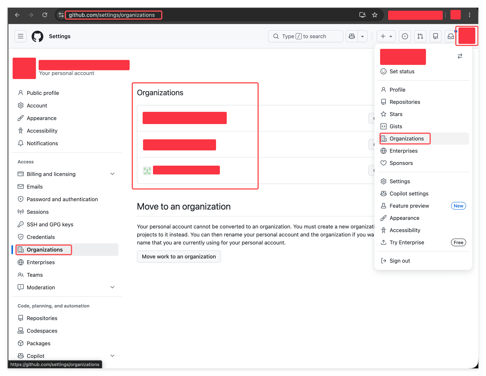
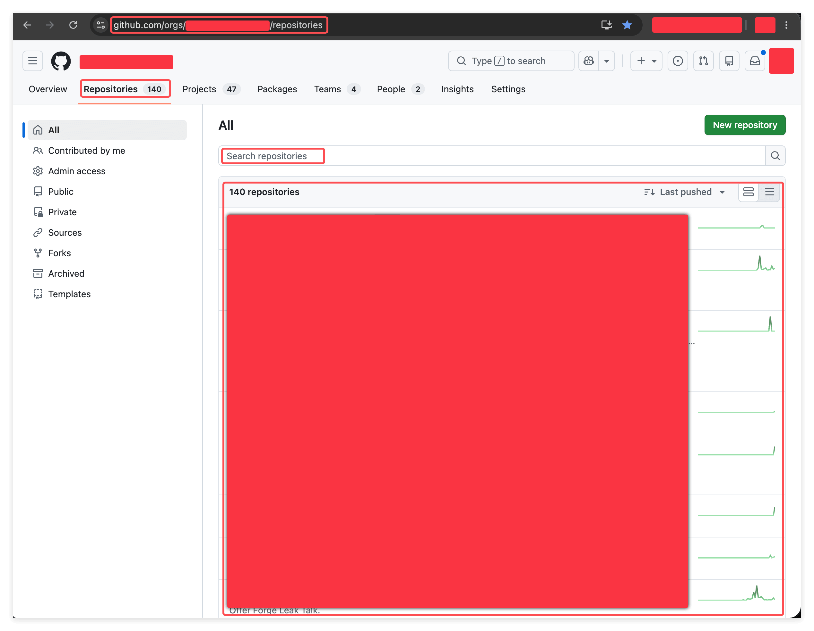
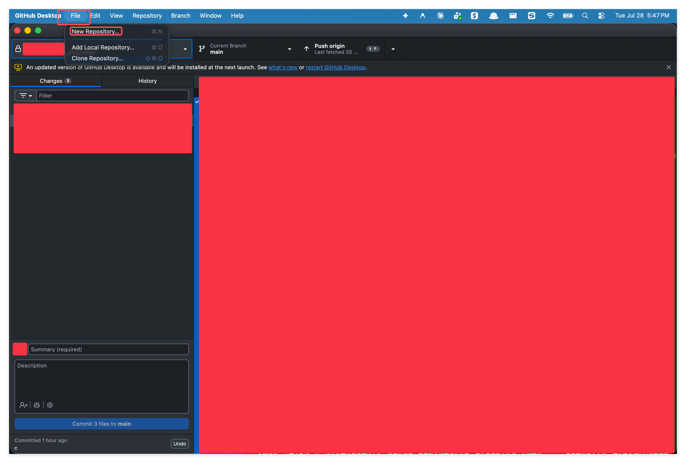
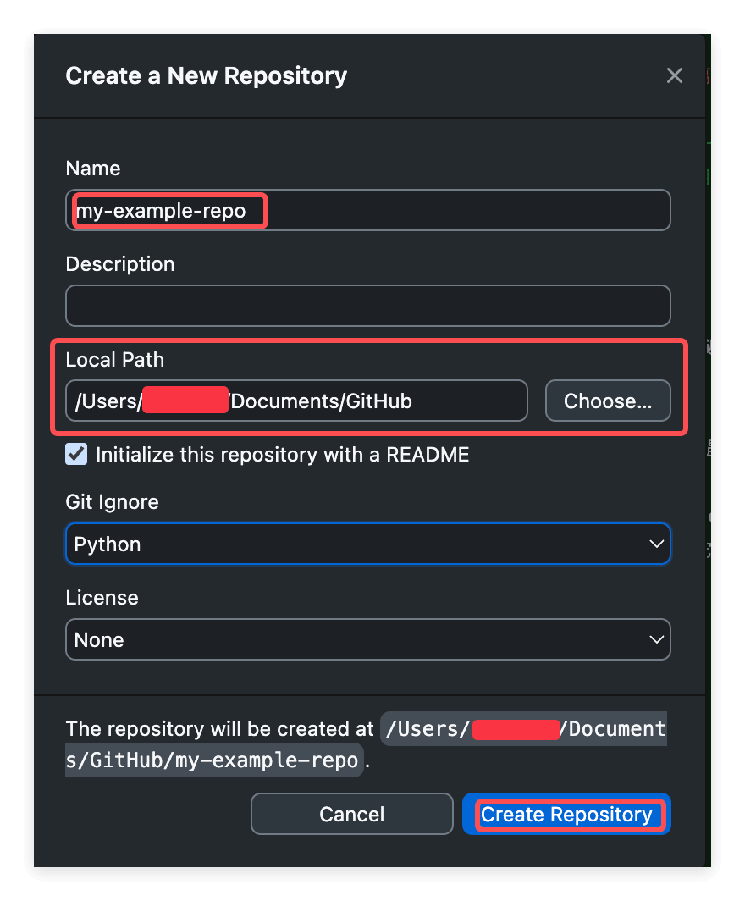
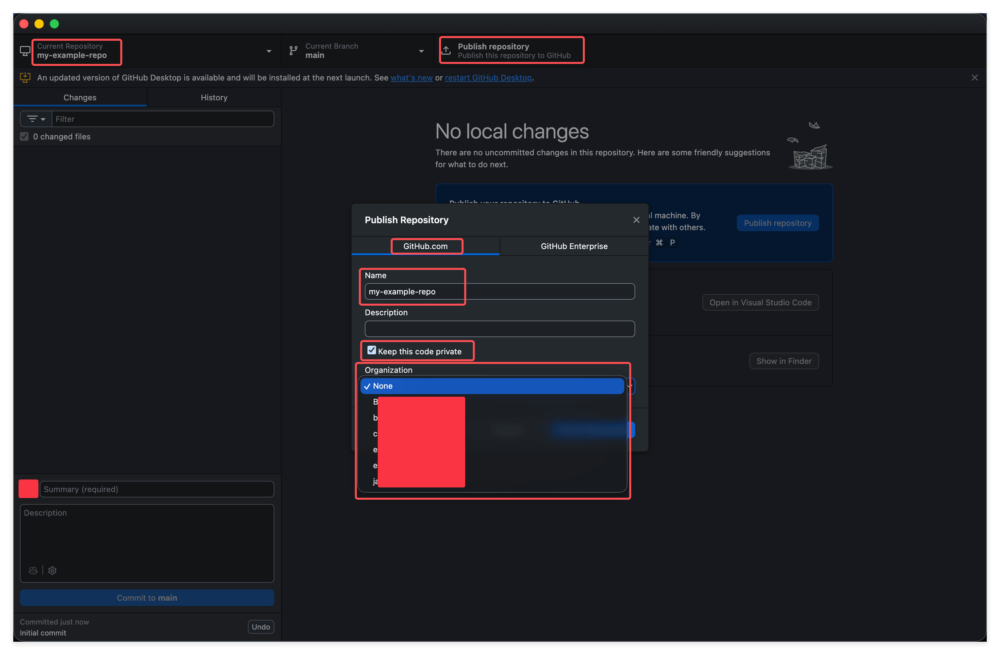

# 看懂 Repo 的归属: 个人账号与 GitHub Organization

> 搞清楚一个 repo 到底属于谁, 以及为什么别人分享给你的仓库, 你在自己的列表里怎么翻都翻不到.

## 1. 概览

这是 "Learn GitHub Basics" 系列的第十节. 先讲一个几乎每个人都会撞上一次的场景.

有人跟你说, 仓库已经分享给你了, 你去看吧. 你登录 GitHub, 点开自己的 Repositories, 从头翻到尾, 没有. 再刷新一遍, 还是没有. 你开始怀疑对方是不是搞错了, 或者权限没给对.

其实多半什么都没错. 那个仓库确实存在, 你也确实有权限, 只是它不在你名下, 而在一个 organization 名下. 你在自己的房间里找一件放在公司柜子里的东西, 当然找不到.

这一节就把这件事讲透: GitHub 上的每个 repo 都属于某一个 owner, owner 可能是一个人, 也可能是一个 organization. 认清了这个, 你就不会再在错的地方翻半天.

---

## 2. 学习目标

前面九节, 你操作的一直是你自己创建的 repo, 它们理所当然都在你自己名下, 所以 "归属" 这件事你完全没有感觉. 可一旦你开始和别人打交道, 无论是进一家公司, 加入一个团队, 还是被拉进一个项目, 你接触到的大部分仓库就都不是你自己建的了. 这时候 "这个仓库属于谁" 立刻变成一个每天都要面对的问题.

这一节要给你的不是操作, 而是一根弦: 拿到任何一个仓库, 先看它的 owner 是谁. 有了这根弦, 找不到仓库这类事就不会再困住你.

学完这个 Task, 你将能够:

1. 说清一个 repo 的完整坐标是 owner 加仓库名, 并能从一个 URL 里一眼读出它的 owner.
2. 用自己的话解释 Organization 是什么, 以及它和个人账号的关系.
3. 知道自己加入了哪些 organization, 并能在其中准确找到某个仓库.
4. 明白自己创建 repo 时, 同样在做一次 owner 的选择.

---

## 3. 前置知识

- 已完成本课的 01 到 09 节, 会创建 repo, 也用过 GitHub Desktop.
- 一个可以正常登录的 GitHub 账户.
- 装好并登录了 GitHub Desktop (本节最后一个观察用得上, 没装也不影响读懂).

---

## 4. 你将构建或学到什么

这一节不产出任何新东西, 也不要求你去建什么. 你要得到的是一套判断力: 看到一个仓库, 知道它属于谁; 找不到一个仓库, 知道该去哪找; 自己建一个仓库, 知道它会落在谁名下.

---

## 5. 一个 repo 的完整坐标是 owner 加仓库名

我们从最直观的地方入手, 也就是地址栏.

任何一个 GitHub 仓库的 URL 都长这个样子: `github.com/OWNER/REPO`. 比如 `github.com/john-doe/my-notes`, 前面那段 `john-doe` 是 owner, 后面那段 `my-notes` 才是仓库名.

关键在于: 仓库名本身不唯一. 全 GitHub 可能有几千个叫 `my-notes` 的仓库, 它们互不相干, 各自属于不同的 owner. 真正唯一的是 owner 加仓库名这一对, 也就是完整的那条 URL.

所以以后别人跟你说仓库名的时候, 光记住名字是不够的. 你要么问清楚 owner 是谁, 要么直接让对方把完整 URL 发给你. 这是最省事, 也最不会出错的做法.

---

## 6. Organization 本质上也是一个账号

那么 URL 里的 owner 到底是什么? 答案比你想的简单: 它就是一个账号.

GitHub 上有两种账号能拥有仓库. 一种是个人账号, 也就是你注册时拿到的那个, 背后是一个具体的人. 另一种叫 Organization, 它背后不是一个人, 而是一个公司, 一个团队, 或者一个开源项目. 但从 GitHub 的角度看, 两者是同一类东西: 都是账号, 都有一个全局唯一的名字, 都能拥有仓库, 都能出现在 URL 的 owner 那一段.

换句话说, 当你看到 `github.com/some-company/some-repo` 的时候, 你没办法只从 URL 判断 `some-company` 是一个人还是一个组织, 因为在结构上它们的位置完全一样. 点进去看一眼就知道了.

为什么要有 organization 这种账号? 因为很多东西不该属于某一个人. 公司的项目挂在 organization 名下, 人来人往, 仓库始终在那里; 如果挂在某个员工的个人账号下, 那人一走就麻烦了. 开源项目也一样, 挂在组织名下, 谁来维护都行.

至于 organization 内部怎么管人, 怎么分组, 那是另一套东西, 这一节完全不碰. 你现在只需要知道: 它是一个能拥有仓库的账号.

---

## 7. 你自己建的 repo, 只在你自己名下

回到那个找不到仓库的困惑, 现在可以解释清楚了.

你自己创建的仓库, owner 就是你, 所以它们全都躺在你的个人账号下, 也就是 01 节 "找回你的 Repo" 那一节教过的地方: 点右上角头像, 选 Repositories, 或者直接访问 `github.com/USERNAME?tab=repositories`.

这个列表很干净, 但它有一个很容易被忽略的边界: **它只列你自己名下的仓库**. 别人分享给你的, organization 名下的, 统统不在这里.

所以当你在这个列表里翻不到某个仓库时, 第一反应不该是 "对方没给我权限", 而应该是 "它是不是根本就不在我名下". 十有八九是后者.

---

## 8. 怎么知道自己在哪些 Organization 里

既然仓库可能在 organization 名下, 那下一个问题就是: 我到底属于哪些 organization?

点右上角头像, 菜单里有一项 Organizations, 点进去就能看到一份清单, 列出你加入了的所有 organization.

这份清单值得你在入职或加入一个新团队之后专门去看一眼. 它等于告诉你: 除了自己名下那一摊, 你还能在哪几个地方找东西.

如果这份清单是空的, 说明你目前不属于任何 organization, 那也很正常, 学习阶段的账号基本都是这样.

---

## 9. 怎么在 Organization 里找到那个仓库

知道自己在哪个 organization 之后, 找仓库就有路径了: 点进那个 organization, 再点顶部的 Repositories 标签.

注意看这张图右上角的数字, 这个 organization 下有 140 个仓库. 真实公司里几百个仓库是很常见的, 靠往下翻是翻不到的, 一定要用页面上那个搜索框. 左边还有一列筛选, 可以只看 public 的, 只看 private 的, 或者只看你参与过的, 缩小范围很有用.

顺便记一下这个页面的地址: `github.com/orgs/ORG_NAME/repositories`. 知道 organization 的名字, 直接把地址拼出来就能到.

---

## 10. 能打开一个仓库, 不等于你加入了那个 Organization

这里有一个细节, 不讲清楚很容易让人困惑.

"能访问某一个仓库" 和 "加入了某个 organization" 是两件不同的事. 对方完全可以只把你加成某一个仓库的 collaborator (就是 07 节讲的那件事), 而不把你拉进 organization. 这时候会出现一个看起来很矛盾的现象: 那个仓库的 URL 你打得开, 内容你也看得到, 但你在 Organizations 清单里找不到这个组织, 更浏览不了它的仓库列表. 因为你确实没在里面, 你只是拿到了其中一扇门的钥匙.

这种情况下, 唯一可靠的入口就是那条完整的 URL. 所以又回到第 5 节那句话: 让对方把完整 URL 发给你, 别只报一个仓库名. 这一条能替你省掉大量的来回确认.

---

## 11. 反过来看: 你自己建 repo 时, 也在选 owner

前面讲的都是找别人的仓库. 现在换个方向: 你自己建仓库的时候, 其实也在做同一个选择, 只是以前你没注意.

01 节创建 repo 的页面上有一个 Owner 下拉, 当时你的账号大概只有自己一个选项, 所以一眼带过了. 一旦你加入了 organization, 那个下拉里就会多出几个选项, 你必须想清楚这个仓库该落在谁名下.

在 GitHub Desktop 里, 这件事分成了两步, 反而更清楚. 第一步, File 菜单里选 New Repository.

第二步, 在弹出的对话框里填名字, 选本地路径, 顺手可以勾上 README, 选一个 Git Ignore 和 License, 点 Create Repository.

请注意, 到这一步为止, 这个仓库还完全只活在你自己电脑上, GitHub 上什么都没有. 这正是 09 节讲过的 local 和 remote 那条界线.

第三步才是重点. 点顶部的 Publish repository, 在弹出的窗口里, 除了名字和 "Keep this code private" 之外, 还有一个 Organization 下拉.

这个下拉默认是 None, 意思是发布到你自己名下. 展开它, 你所在的每一个 organization 都会列在里面, 选谁, 这个仓库的 owner 就是谁, URL 里那一段也就跟着定了.

这里有个理解上的小窍门: 你可以把自己的个人账号当成一个特殊的 organization, 只不过它只有你一个人, 也加不进别人. 这样一来, 无论选 None 还是选某个组织, 你做的都是同一件事, 给这个仓库挑一个家.

这个选择要在发布前想清楚, 因为它决定了这个仓库将来归谁, 谁能看到它, 以及别人要去哪里找它.

---

## 12. 练习

这一节不需要你创建或改动任何东西, 三个练习都是打开来看一眼, 建立感觉就够了.

### 练习 1: 读出一个仓库的 owner

**目标:** 养成看 owner 的习惯.

**怎么做:**

1. 打开你自己的任意一个 repo, 看地址栏, 说出 `github.com/` 后面那一段是谁.
2. 再随便打开一个你知道的知名开源项目, 同样看它的 owner 那一段.
3. 点一下那个 owner 的名字, 进它的主页, 看看它是一个人还是一个 organization.

**你会观察到:**

个人账号的主页有头像, 有 contribution graph; organization 的主页则是 Repositories, People, Teams 这一类标签. 结构上 owner 的位置完全一样, 但点进去一看就知道是哪一种.

> **关键洞见:** 仓库名不唯一, owner 加仓库名才唯一. 记地址比记名字可靠.

### 练习 2: 看看你在哪些 Organization 里

**目标:** 知道除了自己名下, 你还能去哪里找仓库.

**怎么做:**

1. 点右上角头像, 选 Organizations, 看看清单里有哪些.
2. 如果有, 随便点进一个, 再点顶部的 Repositories 标签, 用搜索框搜一个关键字试试.
3. 如果一个都没有, 就把这个页面记在心里, 将来入职或加入团队后第一时间回来看它.

**你会观察到:**

organization 的仓库列表和你自己那份是两个完全独立的列表. 这也正好解释了为什么在自己的列表里怎么翻都翻不到别人分享给你的东西.

> **关键洞见:** 找不到仓库时, 先问自己一句, 我是不是在错的地方找.

### 练习 3: 看一眼 Publish 时的 Organization 下拉

**目标:** 亲眼看到 "选 owner" 这个动作长什么样.

**怎么做:**

1. 打开 GitHub Desktop, File 菜单选 New Repository, 随便起个名字 (比如 `my-example-repo`), 选好本地路径, 点 Create Repository.
2. 点顶部的 Publish repository.
3. 在弹出的窗口里展开 Organization 下拉, 看一眼里面有哪些选项.
4. 看完直接关掉窗口, 不用真的发布. 本地那个文件夹你想删就删.

**你会观察到:**

下拉里默认选中的是 None (发布到你自己名下), 下面列着你所在的每一个 organization. 如果你不属于任何组织, 那里就只有 None 一项, 这也正常, 说明你现在建的所有仓库都会落在自己名下.

> **关键洞见:** 每个仓库从诞生的那一刻起就有一个 owner. 这不是可选项, 只是有时候你没得选而已.

---

## 13. 回顾: 我们学到了什么

- 每个 repo 的完整坐标是 owner 加仓库名, 也就是 `github.com/OWNER/REPO` 这条 URL, 仓库名本身并不唯一.
- owner 是一个账号. 个人账号背后是一个人, Organization 背后是一个公司或团队, 但两者都能拥有仓库, 在 URL 里的位置也完全一样.
- 你自己名下的仓库列表只列你自己的, 别人分享给你的不会出现在这里, 这就是找不到仓库最常见的原因.
- 想知道自己在哪些组织里, 走头像菜单的 Organizations; 想在组织里找仓库, 进 organization 的 Repositories 标签用搜索框.
- 能打开一个仓库不等于你加入了那个组织, 你可能只是那一个仓库的 collaborator. 这时候完整 URL 就是你唯一可靠的入口.
- 你自己建 repo 时也在选 owner. 网页上是那个 Owner 下拉, GitHub Desktop 里是 Publish 时的 Organization 下拉.

---

## 14. 导师寄语

**为什么这件事重要:**

这一节没教你任何新操作, 但它解决的是一个真实工作里天天发生的卡点. 一个人如果脑子里没有 owner 这个概念, 就会反复经历同一种挫败: 明明说好给我了, 我怎么就是找不到. 而只要建立起这根弦, 同样的场景在你这里就只是十秒钟的事, 问一句完整 URL, 或者进 organization 搜一下, 结束.

**关键洞见:**

- GitHub 的世界里没有孤立的仓库, 每一个都挂在某个账号下. 先想清楚 owner, 再想仓库, 顺序反了就容易迷路.
- 个人账号和 organization 的差别, 说到底是归属的差别. 属于个人的东西跟着人走, 属于组织的东西留在组织里. 这也是为什么公司的项目从来不建在员工个人名下.
- 传递仓库信息时, 完整 URL 永远比仓库名可靠. 这是一个很小的习惯, 但能省掉大量的沟通成本.

**下一步:**

从今天起, 每次拿到一个仓库, 先扫一眼地址栏的 owner. 将来你加入一个新团队时, 第一件事就是去 Organizations 看看自己被加进了哪些组织, 再进去把仓库列表扫一遍. 这两个动作加起来不到两分钟, 却能让你对自己能碰到什么东西心里有数.

---

## 15. 速查

**仓库的完整坐标:** `github.com/OWNER/REPO`. owner 可能是个人账号, 也可能是 organization.

**找自己的仓库:** 头像菜单里的 Repositories, 或 `github.com/USERNAME?tab=repositories`. 只列你自己名下的.

**看自己在哪些组织:** 头像菜单里的 Organizations.

**找组织里的仓库:** `github.com/orgs/ORG_NAME/repositories`, 用页面上的搜索框, 别靠翻.

**创建时选 owner:** 网页端是创建页面的 Owner 下拉; GitHub Desktop 是 Publish repository 窗口里的 Organization 下拉, None 表示发到你自己名下.

**一句话记住:** 找不到仓库, 先看 owner, 不在你名下就去 organization 里找.
