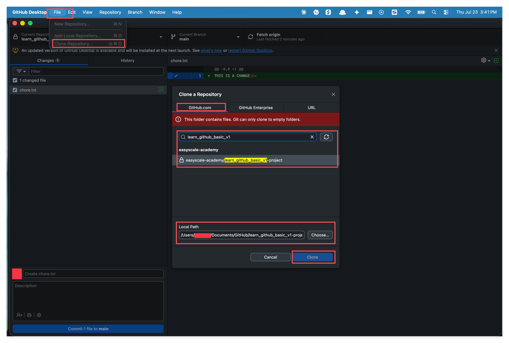
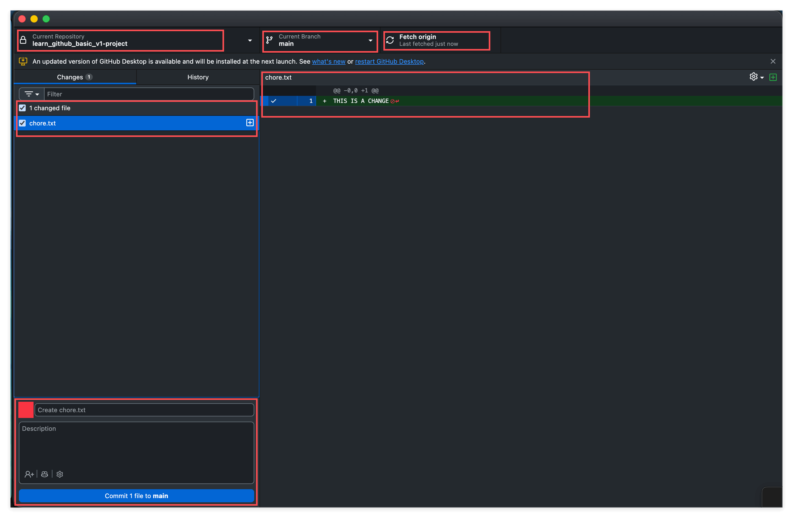
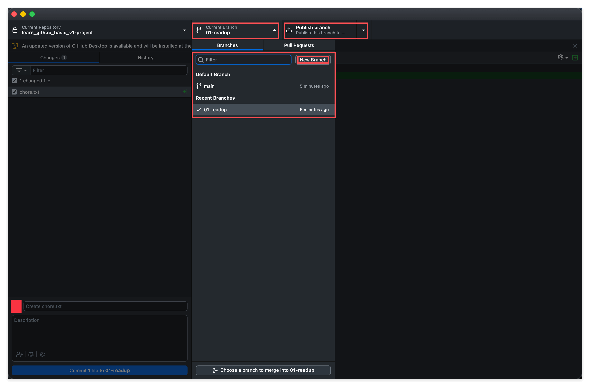
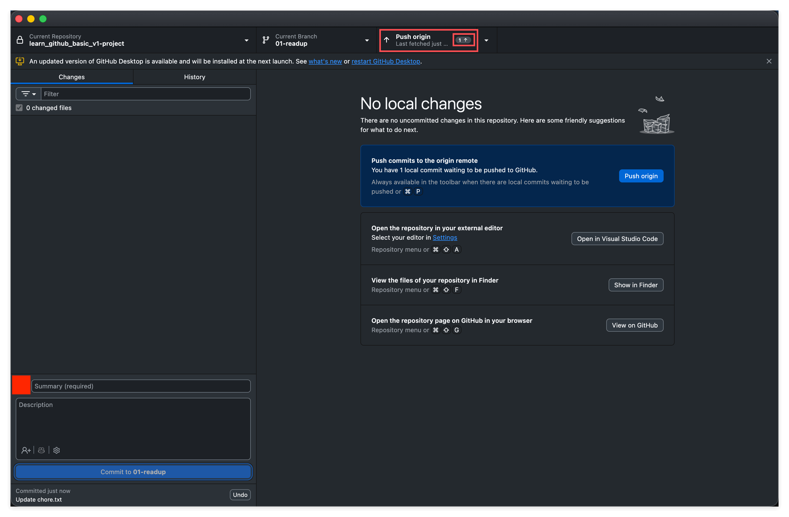
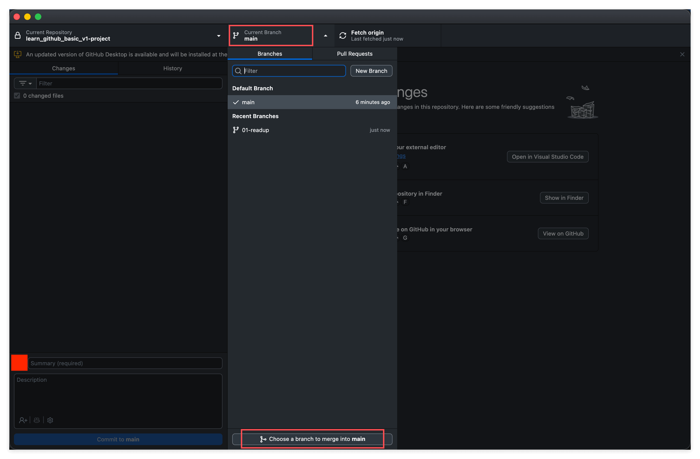
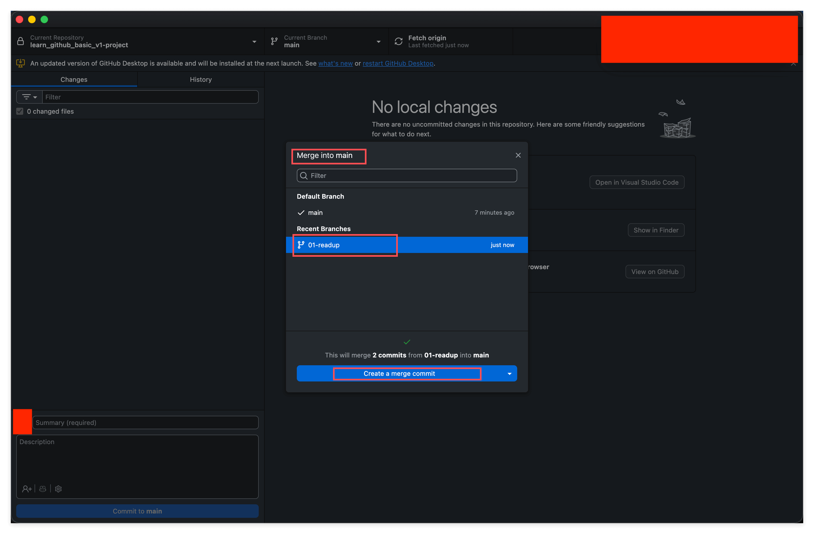

# Manage Your Repo Locally with GitHub Desktop

> Take everything you learned on the web and do it comfortably on your own computer with a graphical interface.

## 1. Overview

This is lesson 11 of the "Learn GitHub Basics" series. Up to now, everything you have done has happened on the GitHub website: editing files, committing, creating branches, merging. You can do all of that in a browser, but honestly the experience is just okay. The web editor is limited, and even typing in it feels clunky.

In this lesson we switch to something much more comfortable: GitHub Desktop, the official desktop app, which lets you do the same things right on your own computer. Think of it this way. You used to do everything through a bank's website, one transaction at a time; now you have installed a mobile banking app, and every action feels smooth. The files are the same files, GitHub is the same GitHub, only the way you work with them is a lot nicer. By the end of this lesson, everything you already know, clone, commit, branch, push, merge, you will be able to do comfortably on your local machine.

---

## 2. Learning Goals

Let's start with a simple fact: in a real work environment, almost nobody writes code or edits documents on the GitHub website. Everyone writes things in an editor on their own computer and then syncs them up to GitHub. That is how the pros work.

Why? Because the local experience is in a different league from the web. Typing is smoother, you can open several files side by side to compare them, you can work offline without depending on a network, and you can bring in all kinds of AI assistants to help you write. Once you learn to work locally, you move from "clicking around on a web page" to "working like a professional developer."

By the end of this Task, you will be able to:

1. Explain what GitHub Desktop is, and how local and remote relate to each other.
2. Use GitHub Desktop to clone a repo to your computer.
3. Edit, commit, create a branch, switch branches, and push, all locally.
4. Merge a branch into main directly on your machine, without going through a Pull Request.

---

## 3. Prerequisites

- You have finished lessons 03 through 10 of this course and are comfortable with commit, branch, and merge (you have done them all on the web).
- A Mac or Windows computer (GitHub Desktop supports both, and the steps are almost identical).
- A repo you have permission to change, ideally the public practice repo you created in the earlier lessons.

---

## 4. What You Will Build or Learn

This lesson does not involve writing any new code or documents. What you will do is redo, from start to finish and locally, everything you previously learned on the web. When you are done, you will have your own local workflow, a skill you will use almost every day from here on.

---

## 5. What GitHub Desktop Is

GitHub Desktop is an official desktop app from GitHub. What it does is simple: it lets you work with Git through a graphical interface, without typing commands on the command line.

You can think of it as the "local version" of the GitHub website. Anything you can do on the web (commit, branch, push, merge) you can also do in GitHub Desktop, and more intuitively. Here is how it divides the work with the website:

- GitHub website (github.com): where your project lives in the cloud, exposed to others according to the visibility you set.
- GitHub Desktop (the desktop app): a tool on your computer that keeps your local files in sync with the cloud.

As for what you use to edit files, take your pick. Notepad or TextEdit both work, but VS Code is the better choice (free, capable, and the most popular). The star of this lesson is GitHub Desktop; the editor is just a supporting player, so use whatever feels comfortable.

---

## 6. Local and Remote: A Concept You Must Nail Down

This concept is extremely important, so get it straight first:

- remote: the repo on the GitHub website, the one you see in your browser.
- local: the folder on your computer. After you clone a repo, you have a complete copy of it on your machine.

The two stay in sync through three actions:

- Clone: the first-time, complete copy of a remote repo to your machine. You only do it once.
- Pull: bring the latest changes down from remote to local (someone changed something, and you pull it in).
- Push: send your local changes up to remote (you changed something, and you push it up).

The key point: everything you do locally (editing, committing, creating a branch) exists only on your own computer until you push, and the website shows nothing of it. Only after you push does the remote update. This is actually an advantage. You can change and experiment freely on your machine, and if you are not happy with something, just don't push it, and the remote is not affected at all.

---

## 7. Setup: Install and Sign In to GitHub Desktop

1. Open a browser, go to desktop.github.com, download the version for your system (Windows or Mac), and install it.
2. Open GitHub Desktop and click Sign in to GitHub.com.
3. In the browser page that pops up, sign in to your GitHub account and authorize it.
4. Once you are signed in, GitHub Desktop shows your username, which means it is connected to your account.

This install-and-sign-in step only needs to be done once; after that it remembers you.

---

## 8. Clone: Copy the Repo to Your Computer

Clone means making a complete copy of the remote repo onto your computer. When it is done, you have all of the repo's files on your machine, and you can open it like any ordinary folder.

In GitHub Desktop, click File, choose Clone Repository, and the dialog below pops up.

- The default GitHub.com tab lists every repo you have access to, with a search box on top, so you can filter by name. It is the friendliest option for beginners.
- There is also a URL tab next to it, where you can paste a repo's clone URL (something like https://github.com/username/repo-name). It works the same way, just without the convenience of searching.

One detail here is worth noticing: this list shows every repo you have access to, not just the ones you created yourself. If you are on a team or at a company, the team's repositories show up here too, grouped by owner. Right now you probably only see your own handful, so it does not feel like much; once your repositories start coming from more places, that grouping becomes very useful. As for what that "owner" actually is, lesson 12 covers it specifically.

Select the repo you want to clone, pick a location for it under Local Path (say, a folder on your desktop), click the blue Clone button, and wait a few seconds. When it is done, open that Local Path folder and you will see all the files in the repo.

---

## 9. Commit: Change a File Locally and Commit It

Remember clicking the pencil icon in lesson 04 to edit a file on the web? Now you will do the same thing locally.

In that local folder, open a file in your editor (say, README.md), change something, and save. Then switch back to GitHub Desktop, which has already detected your change automatically.

- The Changes panel on the left lists which files were changed.
- The right side shows exactly what changed, with added lines in green and deleted lines in red.
- In the Summary box in the lower left, write a meaningful commit message, then click the blue Commit to main.

Congratulations, you have made a commit locally. But remember one thing: this commit is only on your computer for now, and the website still shows nothing. To make it appear on the remote, you have one more step to do, push.

---

## 10. Branch: Create and Switch Locally

Remember branches from lesson 05? In GitHub Desktop, creating and switching branches is even more intuitive.

- Create a branch: click the Current Branch area at the top to open the panel, click New Branch, give it a name (say, dev-local), and create it based on main.
- Switch branches: again click that area at the top, pick the branch you want in the list, and one click takes you there.

Try changing something on the new branch and committing it, then switch back to main and look, you will find that change is gone; switch back to the new branch and it returns. This is the "parallel universe" you experienced in lesson 05, now available locally too, and switching is faster.

Note: a newly created branch also lives only locally. Just like a commit, it appears on the remote only after you push (the first push is called Publish branch).

---

## 11. Push: Send Local Changes to the Remote

Local commits and newly created branches do not sync automatically. To make them show up on the GitHub website, you rely on push.

- A Push origin button appears at the top, and the number next to it (say, a 1 with an up arrow) tells you how many local commits you have not pushed yet. Click it, wait a few seconds, and it is pushed up.
- If it is a freshly created branch that has never been published, this button shows as Publish branch. It means the same thing, syncing your local work up to the remote.

After the push, open the repo's GitHub page in a browser and your change and commit message are right there. Remember this rhythm: edit, commit, push. The first two steps are local; only the third truly syncs to the remote.

---

## 12. Local Merge: Combine Directly Without a PR

In lesson 06 you learned to merge on the web through a Pull Request. But locally, when you are working on your own, you can merge directly, which is faster and simpler.

First, switch to main in GitHub Desktop. Since you are merging another branch "into" main, you need to be standing on main first. Then open the branch panel at the top and click Choose a branch to merge into main at the very bottom.

Second, in the Merge into main window that pops up, select the branch you want to bring in (say, dev-local). The window tells you how many commits this will merge over, and after you confirm, click Create a merge commit.

Once the merge is done, open a file on main and take a look, and what you added on that branch now appears in main too. Don't forget the final Push origin to send the merged main up to the remote.

There is one key distinction to make clear here. A local merge and a Pull Request do the same job: both combine one branch's changes into another. The difference is that a PR adds two things, review and a record, which makes it a good fit for team collaboration, since who changed what and why it was merged all leave a trace; a local merge has no review and no PR record, it just merges. When you are the only person using the repo, a local merge is perfectly enough and saves effort. The moment collaboration with others is involved, you should go back to using a PR.

---

## 13. Exercises

### Exercise 1: Clone Your Own Repo and Run Through It Locally

**Goal:** Use GitHub Desktop plus a local folder to do clone, commit, branch, push, and a local merge from start to finish.

**What to do:**

1. First decide which repo you want to practice on. The public practice repo you created in the earlier lessons is the best fit: it is under your own account, you have permission, and you can experiment freely. If you can't recall the name, take a look at github.com/USERNAME?tab=repositories (replace USERNAME with your username).
2. In GitHub Desktop, click File, Clone Repository, find it under the GitHub.com tab, pick a Local Path, and click Clone.
3. In the local folder, change a file in your editor and save, go back to GitHub Desktop, write a commit message, and Commit to main.
4. Click Push origin, then go to the GitHub website to confirm the change made it up.
5. Create a new branch (say, dev-local), change something on it and commit, then switch back to main to feel the change appear and disappear.
6. Switch to main and use Choose a branch to merge into main to merge that branch in locally, then Push origin one last time.

**What you will notice:**

The very same set of clone, commit, branch, push, and merge is far smoother to do locally than on the web. And you will clearly feel that boundary: what you do locally is invisible on the website until you push; after you push, the website syncs immediately.

> **Key insight:** You are not learning a pile of new concepts. You are moving operations you already know into a more professional, more comfortable environment. The tool changed, but the underlying Git logic is exactly the same.

---

## 14. Recap: Web Versus Local, Side by Side

- Editing files: before, you clicked the pencil on the web and edited in a little box; now, you edit locally in an editor, just like editing a Word document.
- Commit: before, you clicked Commit changes on the web; now, you write a Summary in GitHub Desktop and click Commit.
- Creating a Branch: before, you typed a name into the branch selector on the web; now, you click New Branch in GitHub Desktop.
- Push: before, committing on the web saved it straight to the remote; now, after a local commit you have to click Push origin as an extra step.
- Merge: before, you went through a Pull Request on the web; now, working on your own, you can merge directly from the Branch menu in GitHub Desktop.
- The core difference is just one thing: web operations act directly on the remote, while local operations sync to the remote only when you push.

---

## 15. A Note from Your Mentor

**Why this lesson is a turning point:**

Starting today, the way you work changes qualitatively. Before, everything you did depended on a browser: open a web page, click the pencil, change a few words in a little box, click save. That approach works, but it is very limited. Now you have a complete local working environment, with the editor handling the writing and GitHub Desktop handling version management. This is not just a change of tools; it means you can work like a professional developer: open the whole project at once, edit and commit even offline, and keep your changes visible only to yourself until you push, without fear of someone seeing a mistake.

**Key insights:**

- That line between local and remote is the most valuable concept in this lesson. Once you are clear on "is this step only local, or already synced to remote," you will never again be confused by "I definitely changed it, so why isn't it on the website."
- A local merge and a PR do not replace each other; each has its place: use a local merge when you are solo and want speed, and use a PR when you need collaboration and a paper trail.
- The more comfortable the tool, the more willing you are to commit and record often. That comfort itself is a form of productivity.

**Next step:**

Build yourself a steady rhythm: open GitHub Desktop, pick your repo, first Fetch origin to see whether the remote has updates, then edit in your editor, commit when you are done, and push. Once you are fluent, the whole thing takes under ten seconds and becomes muscle memory, as automatic as hitting save.

---

## 16. Quick Reference

**GitHub Desktop core operations:**

- Clone repo: File, Clone Repository, search under the GitHub.com tab or paste the address under the URL tab.
- Create a branch: click Current Branch at the top, New Branch.
- Switch branches: click Current Branch at the top, pick the target branch in the list.
- Commit: write a Summary in the lower left, click Commit to [branch].
- Push: Push origin at the top (the first push of a new branch is Publish branch).
- Local merge: switch to the target branch first, then Choose a branch to merge into [branch], pick the source branch, Create a merge commit.

**Download links:**

- GitHub Desktop: desktop.github.com
- VS Code (an optional editor): code.visualstudio.com

**Remember it in one line:** edit, commit, push; what you do locally syncs to the remote only after you push.
